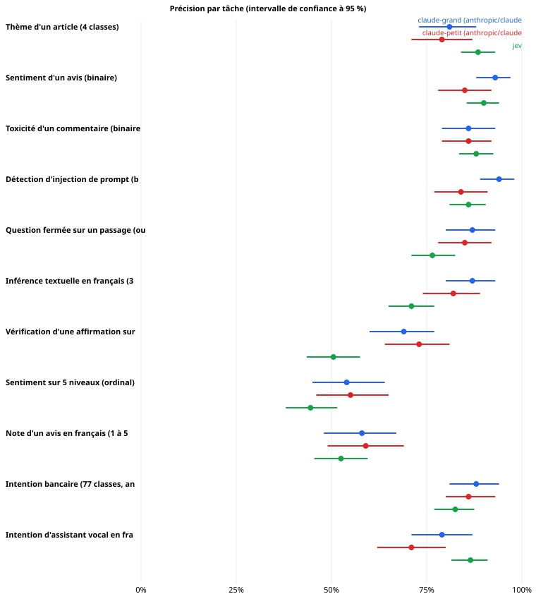
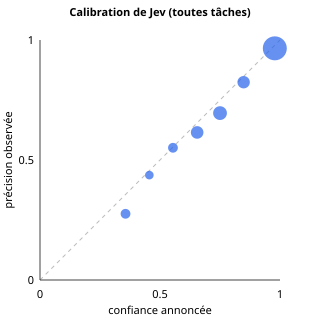
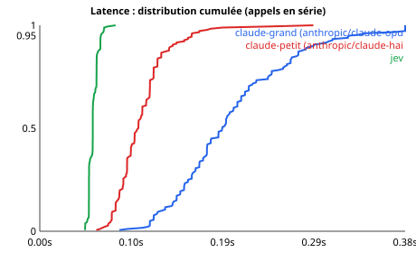

> **⚠️ DONNÉES SIMULÉES.** Ce rapport a été produit contre un serveur factice pour tester la chaîne de mesure. Aucun chiffre ci-dessous ne dit quoi que ce soit de Jev.

# Étude de Jev (TypeSafe, via OpenRouter)

*Généré par `python -m jev_lab report`. Seuils de lecture fixés avant les mesures : voir `PROTOCOL.md`.*

## 0. Statut du run

| | |
|---|---|
| Début | 2026-10-13T14:38:23Z |
| Suite | standard |
| Commit | 1e67ec9 |
| Modèle demandé | typesafe/jev-1.13 |
| Plafond de budget ($) | 50.0 |
| Version de Jev effectivement servie | typesafe/jev-1.13-SIMULE |
| Modèles de comparaison (figés) | claude-petit (anthropic/claude-haiku-5) = `anthropic/claude-haiku-5`, claude-grand (anthropic/claude-opus-5) = `anthropic/claude-opus-5` |
| Appels enregistrés | 11820 (après déduplication des reprises) |
| Dépense rapportée | 9.4921 $  (claude-grand (anthropic/claude-opus-5): 9.1656 $, claude-petit (anthropic/claude-haiku-5): 0.2291 $, jev: 0.0974 $) |

## 1. Ce qu'on peut dire (grille du protocole)

**Puissance statistique (à lire avant tout le reste).** Avec 100 exemples appariés par tâche, l'intervalle sur l'écart de précision fait en médiane **± 11.0 %**. Pour établir qu'un système est équivalent à 3 points près, il faut en médiane **≈ 1362 exemples appariés** (jusqu'à 2251 pour les tâches les plus bruitées). Quand n est plus petit, « inconclusif » est le résultat **normal** : il ne dit pas que Jev est mauvais, il dit que l'échantillon ne permet pas de trancher.

Pour chaque tâche et chaque référence : Jev est-il **supérieur**, **équivalent** (non-inférieur à 3 points près), **inférieur** ou **inconclusif** ? « Recommandé » = au moins équivalent ET au moins 10 fois moins cher.

⚠ Ce tableau contient 22 comparaisons : à 95 %, on s'attend à environ 1 écart(s) « significatif(s) » **par pur hasard**. Le signe † marque un écart qui ne survit pas à la correction de Holm (colonne p (Holm) plus bas) : à ne pas prendre pour une conclusion.

| Tâche | Référence | Écart de précision (Jev − réf.) | Lecture | Rapport de coût (réf./Jev) | Recommandé |
|---|---|---|---|---|---|
| Thème d'un article (4 classes) | claude-grand (anthropic/claude-opus-5) | 9.0 % [0.0 % ; 18.0 %] | **équivalent** | ×231.3 | oui |
| Thème d'un article (4 classes) | claude-petit (anthropic/claude-haiku-5) | 11.0 % [0.0 % ; 22.0 %] | **équivalent** | ×5.8 | non |
| Sentiment d'un avis (binaire) | claude-grand (anthropic/claude-opus-5) | 0.0 % [-7.0 % ; 7.0 %] | **inconclusif** | ×309.5 | non |
| Sentiment d'un avis (binaire) | claude-petit (anthropic/claude-haiku-5) | 8.0 % [-1.0 % ; 17.0 %] | **équivalent** | ×7.7 | non |
| Toxicité d'un commentaire (binaire, classes équilibrées) | claude-grand (anthropic/claude-opus-5) | -1.0 % [-12.0 % ; 9.0 %] | **inconclusif** | ×215.7 | non |
| Toxicité d'un commentaire (binaire, classes équilibrées) | claude-petit (anthropic/claude-haiku-5) | -1.0 % [-11.0 % ; 9.0 %] | **inconclusif** | ×5.4 | non |
| Détection d'injection de prompt (binaire) | claude-grand (anthropic/claude-opus-5) | -14.0 % [-23.0 % ; -5.0 %] | **inférieur †** | ×209.6 | non |
| Détection d'injection de prompt (binaire) | claude-petit (anthropic/claude-haiku-5) | -4.0 % [-15.0 % ; 6.0 %] | **inconclusif** | ×5.2 | non |
| Question fermée sur un passage (oui/non) | claude-grand (anthropic/claude-opus-5) | -12.0 % [-23.0 % ; -1.0 %] | **inférieur †** | ×175.2 | non |
| Question fermée sur un passage (oui/non) | claude-petit (anthropic/claude-haiku-5) | -10.0 % [-20.0 % ; 1.0 %] | **inconclusif** | ×4.4 | non |
| Inférence textuelle en français (3 classes) | claude-grand (anthropic/claude-opus-5) | -18.0 % [-30.0 % ; -6.0 %] | **inférieur †** | ×231.3 | non |
| Inférence textuelle en français (3 classes) | claude-petit (anthropic/claude-haiku-5) | -13.0 % [-24.0 % ; -2.0 %] | **inférieur †** | ×5.8 | non |
| Vérification d'une affirmation sur une preuve (3 classes) | claude-grand (anthropic/claude-opus-5) | -16.0 % [-29.0 % ; -3.0 %] | **inférieur †** | ×184.3 | non |
| Vérification d'une affirmation sur une preuve (3 classes) | claude-petit (anthropic/claude-haiku-5) | -20.0 % [-33.0 % ; -7.0 %] | **inférieur †** | ×4.6 | non |
| Sentiment sur 5 niveaux (ordinal) | claude-grand (anthropic/claude-opus-5) | -8.0 % [-22.0 % ; 5.0 %] | **inconclusif** | ×344.8 | non |
| Sentiment sur 5 niveaux (ordinal) | claude-petit (anthropic/claude-haiku-5) | -9.0 % [-23.0 % ; 5.0 %] | **inconclusif** | ×8.6 | non |
| Note d'un avis en français (1 à 5 étoiles, ordinal) | claude-grand (anthropic/claude-opus-5) | 5.0 % [-8.0 % ; 19.0 %] | **inconclusif** | ×225.3 | non |
| Note d'un avis en français (1 à 5 étoiles, ordinal) | claude-petit (anthropic/claude-haiku-5) | 4.0 % [-10.0 % ; 17.0 %] | **inconclusif** | ×5.6 | non |
| Intention bancaire (77 classes, anglais) | claude-grand (anthropic/claude-opus-5) | -4.0 % [-14.0 % ; 6.0 %] | **inconclusif** | ×250.5 | non |
| Intention bancaire (77 classes, anglais) | claude-petit (anthropic/claude-haiku-5) | -2.0 % [-11.0 % ; 7.0 %] | **inconclusif** | ×6.3 | non |
| Intention d'assistant vocal en français (60 classes) | claude-grand (anthropic/claude-opus-5) | 5.0 % [-6.0 % ; 16.0 %] | **inconclusif** | ×255.2 | non |
| Intention d'assistant vocal en français (60 classes) | claude-petit (anthropic/claude-haiku-5) | 13.0 % [2.0 % ; 25.0 %] | **supérieur †** | ×6.4 | non |

| Point | Constat | Détail |
|---|---|---|
| calibration | **bonne** | ECE 0.030 [IC 95 % 0.020 – 0.047] sur 2200 réponses |
| latence vs claude-grand (anthropic/claude-opus-5) | **nettement plus rapide** | p50 0.056s contre 0.192s (×3.4) |
| latence vs claude-petit (anthropic/claude-haiku-5) | **comparable ou plus lent** | p50 0.056s contre 0.104s (×1.9) |
| déterminisme | **conforme** | 0.0% des exemples changent d'étiquette sur au moins une répétition [IC 95 % 0.0% – 1.8%], 210 exemples |
| bruit noise:600:before : sst2 | **inconclusif** | chute +8.3% [+1.7% ; +16.7%] |
| bruit noise:600:before : xnli_fr | **sensible au bruit** | chute +15.0% [+6.7% ; +25.0%] |
| bruit noise:600:before : ag_news | **inconclusif** | chute +8.3% [+1.7% ; +16.7%] |
| shuffle2 : ag_news | **inconclusif** | 0.0% d'étiquettes changées [IC 95 % 0.0% – 6.0%], n = 60 |
| shuffle2 : xnli_fr | **inconclusif** | 1.7% d'étiquettes changées [IC 95 % 0.3% – 8.9%], n = 60 |
| shuffle1 : ag_news | **inconclusif** | 0.0% d'étiquettes changées [IC 95 % 0.0% – 6.0%], n = 60 |
| shuffle1 : xnli_fr | **inconclusif** | 1.7% d'étiquettes changées [IC 95 % 0.3% – 8.9%], n = 60 |
| prix | **conforme au tarif annoncé** | coût facturé / (tokens × 0,042 $/M) = 1.000 |
| limite annoncée : dates | **limite confirmée (non utilisable)** | précision 60% [47%–72%], hasard 50%, seuil d'usage 90% |
| limite annoncée : comptage | **limite confirmée (non utilisable)** | précision 48% [37%–60%], hasard 11%, seuil d'usage 90% |
| limite annoncée : arith | **limite confirmée (non utilisable)** | précision 55% [43%–67%], hasard 50%, seuil d'usage 90% |
| limite annoncée : max | **limite confirmée (non utilisable)** | précision 65% [53%–77%], hasard 25%, seuil d'usage 90% |

## 2. Qualité par tâche

*Une réponse inexploitable ou un appel échoué compte comme **fausse** (jamais exclue). Les cellules ci-dessous ne sont pas appariées (Jev : plus d'exemples que les références coûteuses) : pour comparer, lire les comparaisons appariées plus bas.*

| Tâche | Système | n | Réponses exploitables | Appels échoués | Précision [IC 95 %] | Autre mesure | Coût / 1 000 appels | Coût par bonne réponse |
|---|---|---|---|---|---|---|---|---|
| Thème d'un article (4 classes) | claude-grand (anthropic/claude-opus-5) | 100 | 100.0 % | 0 | 81.0 % [73.0 % – 88.0 %] | F1 macro 0.801 | 1.5640 $ | 0.001931 $ |
| Thème d'un article (4 classes) | claude-petit (anthropic/claude-haiku-5) | 100 | 100.0 % | 0 | 79.0 % [71.0 % – 87.0 %] | F1 macro 0.794 | 0.0391 $ | 0.000049 $ |
| Thème d'un article (4 classes) | jev | 200 | 100.0 % | 0 | 88.5 % [84.0 % – 93.0 %] | F1 macro 0.884 | 0.006762 $ | 0.000008 $ |
| Sentiment d'un avis (binaire) | claude-grand (anthropic/claude-opus-5) | 100 | 100.0 % | 0 | 93.0 % [88.0 % – 97.0 %] | AUC 0.972 ; précision équilibrée (seuil réglé sur l'autre moitié) 91.0 % | 1.2480 $ | 0.001342 $ |
| Sentiment d'un avis (binaire) | claude-petit (anthropic/claude-haiku-5) | 100 | 100.0 % | 0 | 85.0 % [78.0 % – 92.0 %] | AUC 0.936 ; précision équilibrée (seuil réglé sur l'autre moitié) 82.6 % | 0.0312 $ | 0.000037 $ |
| Sentiment d'un avis (binaire) | jev | 200 | 100.0 % | 0 | 90.0 % [85.5 % – 94.0 %] | AUC 0.963 ; précision équilibrée (seuil réglé sur l'autre moitié) 89.4 % | 0.004032 $ | 0.000004 $ |
| Toxicité d'un commentaire (binaire, classes équilibrées) | claude-grand (anthropic/claude-opus-5) | 100 | 100.0 % | 0 | 86.0 % [79.0 % – 93.0 %] | AUC 0.933 ; précision équilibrée (seuil réglé sur l'autre moitié) 86.6 % | 1.5400 $ | 0.001791 $ |
| Toxicité d'un commentaire (binaire, classes équilibrées) | claude-petit (anthropic/claude-haiku-5) | 100 | 100.0 % | 0 | 86.0 % [79.0 % – 92.0 %] | AUC 0.920 ; précision équilibrée (seuil réglé sur l'autre moitié) 83.1 % | 0.0385 $ | 0.000045 $ |
| Toxicité d'un commentaire (binaire, classes équilibrées) | jev | 200 | 100.0 % | 0 | 88.0 % [83.5 % – 92.5 %] | AUC 0.945 ; précision équilibrée (seuil réglé sur l'autre moitié) 87.8 % | 0.007140 $ | 0.000008 $ |
| Détection d'injection de prompt (binaire) | claude-grand (anthropic/claude-opus-5) | 100 | 100.0 % | 0 | 94.0 % [89.0 % – 98.0 %] | AUC 0.976 ; précision équilibrée (seuil réglé sur l'autre moitié) 94.7 % | 1.5760 $ | 0.001677 $ |
| Détection d'injection de prompt (binaire) | claude-petit (anthropic/claude-haiku-5) | 100 | 100.0 % | 0 | 84.0 % [77.0 % – 91.0 %] | AUC 0.938 ; précision équilibrée (seuil réglé sur l'autre moitié) 85.1 % | 0.0394 $ | 0.000047 $ |
| Détection d'injection de prompt (binaire) | jev | 200 | 100.0 % | 0 | 86.0 % [81.0 % – 90.5 %] | AUC 0.929 ; précision équilibrée (seuil réglé sur l'autre moitié) 85.4 % | 0.007518 $ | 0.000009 $ |
| Question fermée sur un passage (oui/non) | claude-grand (anthropic/claude-opus-5) | 100 | 100.0 % | 0 | 87.0 % [80.0 % – 93.0 %] | AUC 0.947 ; précision équilibrée (seuil réglé sur l'autre moitié) 85.8 % | 1.8840 $ | 0.002166 $ |
| Question fermée sur un passage (oui/non) | claude-petit (anthropic/claude-haiku-5) | 100 | 100.0 % | 0 | 85.0 % [78.0 % – 92.0 %] | AUC 0.924 ; précision équilibrée (seuil réglé sur l'autre moitié) 78.8 % | 0.0471 $ | 0.000055 $ |
| Question fermée sur un passage (oui/non) | jev | 200 | 100.0 % | 0 | 76.5 % [71.0 % – 82.5 %] | AUC 0.858 ; précision équilibrée (seuil réglé sur l'autre moitié) 77.1 % | 0.0108 $ | 0.000014 $ |
| Inférence textuelle en français (3 classes) | claude-grand (anthropic/claude-opus-5) | 100 | 100.0 % | 0 | 87.0 % [80.0 % – 93.0 %] | F1 macro 0.871 | 1.5640 $ | 0.001798 $ |
| Inférence textuelle en français (3 classes) | claude-petit (anthropic/claude-haiku-5) | 100 | 100.0 % | 0 | 82.0 % [74.0 % – 89.0 %] | F1 macro 0.820 | 0.0391 $ | 0.000048 $ |
| Inférence textuelle en français (3 classes) | jev | 200 | 100.0 % | 0 | 71.0 % [65.0 % – 77.0 %] | F1 macro 0.706 | 0.006762 $ | 0.000010 $ |
| Vérification d'une affirmation sur une preuve (3 classes) | claude-grand (anthropic/claude-opus-5) | 100 | 100.0 % | 0 | 69.0 % [60.0 % – 77.0 %] | F1 macro 0.689 | 1.8960 $ | 0.002748 $ |
| Vérification d'une affirmation sur une preuve (3 classes) | claude-petit (anthropic/claude-haiku-5) | 100 | 100.0 % | 0 | 73.0 % [64.0 % – 81.0 %] | F1 macro 0.727 | 0.0474 $ | 0.000065 $ |
| Vérification d'une affirmation sur une preuve (3 classes) | jev | 200 | 100.0 % | 0 | 50.5 % [43.5 % – 57.5 %] | F1 macro 0.503 | 0.0103 $ | 0.000020 $ |
| Sentiment sur 5 niveaux (ordinal) | claude-grand (anthropic/claude-opus-5) | 100 | 100.0 % | 0 | 54.0 % [45.0 % – 64.0 %] | MAE 0.82 niveau ; à ±1 : 88.0 % ; ρ 0.45 | 1.2600 $ | 0.002333 $ |
| Sentiment sur 5 niveaux (ordinal) | claude-petit (anthropic/claude-haiku-5) | 100 | 100.0 % | 0 | 55.0 % [46.0 % – 65.0 %] | MAE 0.93 niveau ; à ±1 : 84.0 % ; ρ 0.30 | 0.0315 $ | 0.000057 $ |
| Sentiment sur 5 niveaux (ordinal) | jev | 200 | 100.0 % | 0 | 44.5 % [38.0 % – 51.5 %] | MAE 0.85 niveau ; à ±1 : 90.0 % ; ρ 0.49 | 0.003654 $ | 0.000008 $ |
| Note d'un avis en français (1 à 5 étoiles, ordinal) | claude-grand (anthropic/claude-opus-5) | 100 | 100.0 % | 0 | 58.0 % [48.0 % – 67.0 %] | MAE 0.81 niveau ; à ±1 : 87.0 % ; ρ 0.43 | 1.5800 $ | 0.002724 $ |
| Note d'un avis en français (1 à 5 étoiles, ordinal) | claude-petit (anthropic/claude-haiku-5) | 100 | 100.0 % | 0 | 59.0 % [49.0 % – 69.0 %] | MAE 0.65 niveau ; à ±1 : 92.0 % ; ρ 0.60 | 0.0395 $ | 0.000067 $ |
| Note d'un avis en français (1 à 5 étoiles, ordinal) | jev | 200 | 100.0 % | 0 | 52.5 % [45.5 % – 59.5 %] | MAE 0.69 niveau ; à ±1 : 93.0 % ; ρ 0.62 | 0.007014 $ | 0.000013 $ |
| Intention bancaire (77 classes, anglais) | claude-grand (anthropic/claude-opus-5) | 100 | 100.0 % | 0 | 88.0 % [81.0 % – 94.0 %] | F1 macro 0.864 | 1.4520 $ | 0.001650 $ |
| Intention bancaire (77 classes, anglais) | claude-petit (anthropic/claude-haiku-5) | 100 | 100.0 % | 0 | 86.0 % [80.0 % – 93.0 %] | F1 macro 0.848 | 0.0363 $ | 0.000042 $ |
| Intention bancaire (77 classes, anglais) | jev | 200 | 100.0 % | 0 | 82.5 % [77.0 % – 87.5 %] | F1 macro 0.820 | 0.005796 $ | 0.000007 $ |
| Intention d'assistant vocal en français (60 classes) | claude-grand (anthropic/claude-opus-5) | 100 | 100.0 % | 0 | 79.0 % [71.0 % – 87.0 %] | F1 macro 0.766 | 1.4360 $ | 0.001818 $ |
| Intention d'assistant vocal en français (60 classes) | claude-petit (anthropic/claude-haiku-5) | 100 | 100.0 % | 0 | 71.0 % [62.0 % – 80.0 %] | F1 macro 0.681 | 0.0359 $ | 0.000051 $ |
| Intention d'assistant vocal en français (60 classes) | jev | 200 | 100.0 % | 0 | 86.5 % [81.5 % – 91.0 %] | F1 macro 0.854 | 0.005628 $ | 0.000007 $ |

### Comparaisons appariées (mêmes exemples)

| Tâche | Réf. | n | Jev | Réf. | Écart [IC 95 %] | p (McNemar) | p (Holm) | n pour trancher à 3 pts | Lecture |
|---|---|---|---|---|---|---|---|---|---|
| Thème d'un article (4 classes) | claude-grand (anthropic/claude-opus-5) | 100 | 90.0 % | 81.0 % | 9.0 % [0.0 % ; 18.0 %] | 0.0931 | 1.0000 | 957 | équivalent |
| Thème d'un article (4 classes) | claude-petit (anthropic/claude-haiku-5) | 100 | 90.0 % | 79.0 % | 11.0 % [0.0 % ; 22.0 %] | 0.0708 | 1.0000 | 1285 | équivalent |
| Sentiment d'un avis (binaire) | claude-grand (anthropic/claude-opus-5) | 100 | 93.0 % | 93.0 % | 0.0 % [-7.0 % ; 7.0 %] | 1.0000 | 1.0000 | 604 | inconclusif |
| Sentiment d'un avis (binaire) | claude-petit (anthropic/claude-haiku-5) | 100 | 93.0 % | 85.0 % | 8.0 % [-1.0 % ; 17.0 %] | 0.1338 | 1.0000 | 921 | équivalent |
| Toxicité d'un commentaire (binaire, classes équilibrées) | claude-grand (anthropic/claude-opus-5) | 100 | 85.0 % | 86.0 % | -1.0 % [-12.0 % ; 9.0 %] | 1.0000 | 1.0000 | 1250 | inconclusif |
| Toxicité d'un commentaire (binaire, classes équilibrées) | claude-petit (anthropic/claude-haiku-5) | 100 | 85.0 % | 86.0 % | -1.0 % [-11.0 % ; 9.0 %] | 1.0000 | 1.0000 | 1164 | inconclusif |
| Détection d'injection de prompt (binaire) | claude-grand (anthropic/claude-opus-5) | 100 | 80.0 % | 94.0 % | -14.0 % [-23.0 % ; -5.0 %] | 0.0066 | 0.1386 | 951 | inférieur † |
| Détection d'injection de prompt (binaire) | claude-petit (anthropic/claude-haiku-5) | 100 | 80.0 % | 84.0 % | -4.0 % [-15.0 % ; 6.0 %] | 0.5966 | 1.0000 | 1373 | inconclusif |
| Question fermée sur un passage (oui/non) | claude-grand (anthropic/claude-opus-5) | 100 | 75.0 % | 87.0 % | -12.0 % [-23.0 % ; -1.0 %] | 0.0576 | 0.9218 | 1404 | inférieur † |
| Question fermée sur un passage (oui/non) | claude-petit (anthropic/claude-haiku-5) | 100 | 75.0 % | 85.0 % | -10.0 % [-20.0 % ; 1.0 %] | 0.1102 | 1.0000 | 1337 | inconclusif |
| Inférence textuelle en français (3 classes) | claude-grand (anthropic/claude-opus-5) | 100 | 69.0 % | 87.0 % | -18.0 % [-30.0 % ; -6.0 %] | 0.0051 | 0.1121 | 1499 | inférieur † |
| Inférence textuelle en français (3 classes) | claude-petit (anthropic/claude-haiku-5) | 100 | 69.0 % | 82.0 % | -13.0 % [-24.0 % ; -2.0 %] | 0.0351 | 0.6315 | 1350 | inférieur † |
| Vérification d'une affirmation sur une preuve (3 classes) | claude-grand (anthropic/claude-opus-5) | 100 | 53.0 % | 69.0 % | -16.0 % [-29.0 % ; -3.0 %] | 0.0259 | 0.4920 | 1873 | inférieur † |
| Vérification d'une affirmation sur une preuve (3 classes) | claude-petit (anthropic/claude-haiku-5) | 100 | 53.0 % | 73.0 % | -20.0 % [-33.0 % ; -7.0 %] | 0.0066 | 0.1386 | 1984 | inférieur † |
| Sentiment sur 5 niveaux (ordinal) | claude-grand (anthropic/claude-opus-5) | 100 | 46.0 % | 54.0 % | -8.0 % [-22.0 % ; 5.0 %] | 0.3317 | 1.0000 | 2215 | inconclusif |
| Sentiment sur 5 niveaux (ordinal) | claude-petit (anthropic/claude-haiku-5) | 100 | 46.0 % | 55.0 % | -9.0 % [-23.0 % ; 5.0 %] | 0.2717 | 1.0000 | 2251 | inconclusif |
| Note d'un avis en français (1 à 5 étoiles, ordinal) | claude-grand (anthropic/claude-opus-5) | 100 | 63.0 % | 58.0 % | 5.0 % [-8.0 % ; 19.0 %] | 0.5601 | 1.0000 | 2016 | inconclusif |
| Note d'un avis en français (1 à 5 étoiles, ordinal) | claude-petit (anthropic/claude-haiku-5) | 100 | 63.0 % | 59.0 % | 4.0 % [-10.0 % ; 17.0 %] | 0.6516 | 1.0000 | 1891 | inconclusif |
| Intention bancaire (77 classes, anglais) | claude-grand (anthropic/claude-opus-5) | 100 | 84.0 % | 88.0 % | -4.0 % [-14.0 % ; 6.0 %] | 0.5716 | 1.0000 | 1201 | inconclusif |
| Intention bancaire (77 classes, anglais) | claude-petit (anthropic/claude-haiku-5) | 100 | 84.0 % | 86.0 % | -2.0 % [-11.0 % ; 7.0 %] | 0.8318 | 1.0000 | 947 | inconclusif |
| Intention d'assistant vocal en français (60 classes) | claude-grand (anthropic/claude-opus-5) | 100 | 84.0 % | 79.0 % | 5.0 % [-6.0 % ; 16.0 %] | 0.4996 | 1.0000 | 1499 | inconclusif |
| Intention d'assistant vocal en français (60 classes) | claude-petit (anthropic/claude-haiku-5) | 100 | 84.0 % | 71.0 % | 13.0 % [2.0 % ; 25.0 %] | 0.0410 | 0.6963 | 1437 | supérieur † |

## 3. Calibration (la confiance de Jev est-elle fiable ?)

ECE global : **0.030** [IC 95 % 0.020 – 0.047] sur 2200 réponses (≤ 0.05 bon, ≤ 0.1 acceptable). Pour une question à oui/non, la confiance est max(p, 1−p).

**Abstention** : précision si l'on ne garde que la part la plus confiante des réponses.

| Part conservée | 100 % | 90 % | 80 % | 50 % |
|---|---|---|---|---|
| Précision | 74.2 % | 79.1 % | 82.5 % | 92.7 % |

| Tâche | ECE | n | Précision à 80 % de couverture |
|---|---|---|---|
| Intention bancaire (77 classes, anglais) | 0.063 | 200 | 89.4 % |
| Sentiment sur 5 niveaux (ordinal) | 0.088 | 200 | 48.8 % |
| Sentiment d'un avis (binaire) | 0.022 | 200 | 95.0 % |
| Toxicité d'un commentaire (binaire, classes équilibrées) | 0.028 | 200 | 93.1 % |
| Inférence textuelle en français (3 classes) | 0.061 | 200 | 76.2 % |
| Vérification d'une affirmation sur une preuve (3 classes) | 0.100 | 200 | 56.9 % |
| Détection d'injection de prompt (binaire) | 0.036 | 200 | 91.2 % |
| Question fermée sur un passage (oui/non) | 0.068 | 200 | 81.2 % |
| Note d'un avis en français (1 à 5 étoiles, ordinal) | 0.064 | 200 | 57.5 % |
| Intention d'assistant vocal en français (60 classes) | 0.048 | 200 | 93.8 % |
| Thème d'un article (4 classes) | 0.033 | 200 | 94.4 % |

Confiance *verbalisée* des modèles de comparaison (indicatif) : claude-petit (anthropic/claude-haiku-5) ECE 0.022, claude-grand (anthropic/claude-opus-5) ECE 0.031

## 4. Latence

Mesure côté client, appels **en série** (un à la fois), connexion persistante (pas de DNS/TLS à chaque appel), systèmes entrelacés, après échauffement. `wall` = tentative réussie ; les attentes de réessai sont comptées à part. Intervalles : bootstrap **par exemple** (les répétitions d'un même exemple ne sont pas indépendantes). Le p50 « poolé » mélange plusieurs tâches de tailles différentes : voir le détail par tâche. Des appels identiques répétés peuvent être mis en cache côté fournisseur (non vérifiable d'ici).

| Système | n | p50 | p90 | p95 | p99 | IC p50 | IC p95 | Échecs |
|---|---|---|---|---|---|---|---|---|
| claude-grand (anthropic/claude-opus-5) | 180 | 0.192 s | 0.288 s | 0.326 s | 0.458 s | [0.180 ; 0.200] | [0.289 ; 0.400] | 0 |
| claude-petit (anthropic/claude-haiku-5) | 180 | 0.104 s | 0.140 s | 0.160 s | 0.202 s | [0.099 ; 0.108] | [0.144 ; 0.176] | 0 |
| jev | 180 | 0.056 s | 0.064 s | 0.064 s | 0.068 s | [0.056 ; 0.056] | [0.064 ; 0.067] | 0 |

**p50 par tâche**

| Tâche | claude-grand (anthropic/claude-opus-5) | claude-petit (anthropic/claude-haiku-5) | jev |
|---|---|---|---|
| Thème d'un article (4 classes) | 0.190 s | 0.096 s | 0.056 s |
| Question fermée sur un passage (oui/non) | 0.188 s | 0.106 s | 0.056 s |
| Vérification d'une affirmation sur une preuve (3 classes) | 0.199 s | 0.112 s | 0.056 s |

Revendication de l'éditeur (blog, tickets courts) : p50 0.194 s, p95 0.633 s.

**Effet de la taille d'entrée** (p50, même exemple avec de plus en plus de contexte)

| Système | +0 tok | +400 tok | +1600 tok | +6400 tok |
|---|---|---|---|---|
| claude-grand (anthropic/claude-opus-5) | 0.206 s | 0.269 s | 0.233 s | 0.160 s |
| claude-petit (anthropic/claude-haiku-5) | 0.101 s | 0.106 s | 0.103 s | 0.105 s |
| jev | 0.059 s | 0.054 s | 0.059 s | 0.062 s |

**Débit et limites de cadence (Jev seul)**

| Concurrence | Appels | Durée | Débit | Réponses 429 | Échecs |
|---|---|---|---|---|---|
| 1 | 16 | 0.9 s | 18.4 /s | 0 | 0 |
| 2 | 16 | 0.4 s | 39.7 /s | 0 | 0 |
| 4 | 32 | 0.4 s | 73.3 /s | 0 | 0 |
| 8 | 64 | 0.4 s | 150.3 /s | 0 | 0 |
| 16 | 128 | 2.2 s | 59.4 /s | 1 | 0 |

**Réessais et erreurs réseau (tous appels)**

| Système | Appels | Réessayés | 429 | 5xx | Réseau | Échecs définitifs |
|---|---|---|---|---|---|---|
| claude-grand (anthropic/claude-opus-5) | 3020 | 0 | 0 | 0 | 0 | 0 |
| claude-petit (anthropic/claude-haiku-5) | 3020 | 0 | 0 | 0 | 0 | 0 |
| jev | 4120 | 0 | 0 | 0 | 0 | 0 |

## 5. Prix

Sur 5735 appels Jev : coût facturé ÷ (tokens d'entrée × 0.042 $/M) = **1.000** (5ᵉ–95ᵉ percentile : 1.000 – 1.000). Prix implicite médian : 0.0420 $/M. Corrélation rang entre tokens de sortie et coût unitaire (devrait être ≈ 0 si la sortie est gratuite) : –.

**Facturation de plusieurs questions dans une requête** (même état, questions identiques répétées)

| Questions | Tokens d'entrée | Coût | Rapport tokens / 1 question |
|---|---|---|---|
| 1 | 162 | 0.000007 $ | ×1.00 |
| 2 | 256 | 0.000011 $ | ×1.58 |
| 4 | 444 | 0.000019 $ | ×2.74 |
| 8 | 821 | 0.000034 $ | ×5.07 |

**Coût comparé** (par 1 000 appels, voir tableau de la section 2) : le coût par bonne réponse est la métrique à retenir pour décider.

## 6. Robustesse

**Détails non pertinents** (texte administratif ajouté). Chute de précision par rapport à la même consigne sans bruit ; ex. « +10,0 % * » = 10 points perdus ; * = l'intervalle de confiance exclut 0. Les « ± x » en pied de cellule sont les étiquettes changées.

| Tâche | Système | n | 150 before tok | 600 before tok | 2400 before tok | 600 after tok | 2400 both tok |
|---|---|---|---|---|---|---|---|
| Thème d'un article (4 classes) | jev | 60 | +1.7 % | +8.3 % * | +18.3 % * | +8.3 % * | +18.3 % * |
| Thème d'un article (4 classes) | claude-grand (anthropic/claude-opus-5) | 60 | +0.0 % | +0.0 % | +0.0 % | +0.0 % | +0.0 % |
| Thème d'un article (4 classes) | claude-petit (anthropic/claude-haiku-5) | 60 | +0.0 % | +0.0 % | +1.7 % | +0.0 % | +1.7 % |
| Sentiment d'un avis (binaire) | jev | 60 | +3.3 % | +8.3 % * | +15.0 % * | +8.3 % * | +18.3 % * |
| Sentiment d'un avis (binaire) | claude-grand (anthropic/claude-opus-5) | 60 | +0.0 % | +0.0 % | +0.0 % | +0.0 % | +0.0 % |
| Sentiment d'un avis (binaire) | claude-petit (anthropic/claude-haiku-5) | 60 | +0.0 % | +0.0 % | +0.0 % | +0.0 % | +0.0 % |
| Inférence textuelle en français (3 classes) | jev | 60 | +5.0 % | +15.0 % * | +23.3 % * | +15.0 % * | +23.3 % * |
| Inférence textuelle en français (3 classes) | claude-grand (anthropic/claude-opus-5) | 60 | +3.3 % | +5.0 % | +5.0 % | +5.0 % | +5.0 % |
| Inférence textuelle en français (3 classes) | claude-petit (anthropic/claude-haiku-5) | 60 | +0.0 % | +0.0 % | +1.7 % | +0.0 % | +1.7 % |

**Ordre des options permuté** : part des exemples dont l'étiquette change quand on permute l'ordre des options (une bonne réponse ne devrait pas en dépendre).

| Tâche | Système | n | permutation 1 | permutation 2 |
|---|---|---|---|---|
| Thème d'un article (4 classes) | jev | 60 | 0.0 % | 0.0 % |
| Thème d'un article (4 classes) | claude-grand (anthropic/claude-opus-5) | 60 | 0.0 % | 0.0 % |
| Thème d'un article (4 classes) | claude-petit (anthropic/claude-haiku-5) | 60 | 0.0 % | 0.0 % |
| Inférence textuelle en français (3 classes) | jev | 60 | 1.7 % | 1.7 % |
| Inférence textuelle en français (3 classes) | claude-grand (anthropic/claude-opus-5) | 60 | 3.3 % | 3.3 % |
| Inférence textuelle en français (3 classes) | claude-petit (anthropic/claude-haiku-5) | 60 | 0.0 % | 0.0 % |

**Sans descriptions** (libellés seuls)

| Tâche | Système | n | Avec descriptions | Sans | Chute [IC 95 %] |
|---|---|---|---|---|---|
| Thème d'un article (4 classes) | jev | 60 | 91.7 % | 91.7 % | 0.0 % [0.0 % – 0.0 %] |
| Thème d'un article (4 classes) | claude-grand (anthropic/claude-opus-5) | 60 | 81.7 % | 81.7 % | 0.0 % [0.0 % – 0.0 %] |
| Thème d'un article (4 classes) | claude-petit (anthropic/claude-haiku-5) | 60 | 73.3 % | 73.3 % | 0.0 % [0.0 % – 0.0 %] |
| Sentiment d'un avis (binaire) | jev | 60 | 93.3 % | 93.3 % | 0.0 % [0.0 % – 0.0 %] |
| Sentiment d'un avis (binaire) | claude-grand (anthropic/claude-opus-5) | 60 | 91.7 % | 91.7 % | 0.0 % [0.0 % – 0.0 %] |
| Sentiment d'un avis (binaire) | claude-petit (anthropic/claude-haiku-5) | 60 | 85.0 % | 85.0 % | 0.0 % [0.0 % – 0.0 %] |
| Inférence textuelle en français (3 classes) | jev | 60 | 68.3 % | 66.7 % | 1.7 % [0.0 % – 5.0 %] |
| Inférence textuelle en français (3 classes) | claude-grand (anthropic/claude-opus-5) | 60 | 90.0 % | 85.0 % | 5.0 % [0.0 % – 11.7 %] |
| Inférence textuelle en français (3 classes) | claude-petit (anthropic/claude-haiku-5) | 60 | 85.0 % | 85.0 % | 0.0 % [0.0 % – 0.0 %] |

## 7. Déterminisme

Même appel répété. L'éditeur annonce des probabilités « légèrement différentes d'une exécution à l'autre ». « Étiquette change » = au moins une des répétitions donne une autre étiquette que les autres.

**Global** : 0.0 % des 210 exemples changent d'étiquette [IC 95 % 0.0 % – 1.8 %] (seuil du protocole : 2 %).

| Tâche | Exemples | Répétitions | Étiquette change | Réponse strictement identique | Écart moyen de probabilité | Écart max |
|---|---|---|---|---|---|---|
| Note d'un avis en français (1 à 5 étoiles, ordinal) | 70 | 5.0 | 0.0 % | 0.0 % | 0.065 | 0.172 |
| Thème d'un article (4 classes) | 70 | 5.0 | 0.0 % | 1.4 % | 0.047 | 0.118 |
| Sentiment d'un avis (binaire) | 70 | 5.0 | 0.0 % | 0.0 % | 0.049 | 0.129 |

## 8. Limites annoncées par l'éditeur (tâches à réponse exacte)

| Tâche | Système | n | Précision [IC 95 %] | Hasard | Meilleur que le hasard ? |
|---|---|---|---|---|---|
| Combien de fois « chat » apparaît ? | claude-petit (anthropic/claude-haiku-5) | 60 | 76.7 % [65.0 % – 86.7 %] | 11 % | oui |
| La somme dépasse-t-elle le seuil ? | claude-petit (anthropic/claude-haiku-5) | 60 | 91.7 % [85.0 % – 98.3 %] | 50 % | oui |
| Quelle date est la plus ancienne ? | claude-grand (anthropic/claude-opus-5) | 60 | 90.0 % [81.7 % – 96.7 %] | 50 % | oui |
| Quel nombre est le plus grand ? | jev | 60 | 65.0 % [53.3 % – 76.7 %] | 25 % | oui |
| Combien de fois « chat » apparaît ? | claude-grand (anthropic/claude-opus-5) | 60 | 86.7 % [78.3 % – 95.0 %] | 11 % | oui |
| Quelle date est la plus ancienne ? | jev | 60 | 60.0 % [46.7 % – 71.7 %] | 50 % | non |
| Quel nombre est le plus grand ? | claude-grand (anthropic/claude-opus-5) | 60 | 96.7 % [91.7 % – 100.0 %] | 25 % | oui |
| La somme dépasse-t-elle le seuil ? | claude-grand (anthropic/claude-opus-5) | 60 | 90.0 % [83.3 % – 96.7 %] | 50 % | oui |
| Quel nombre est le plus grand ? | claude-petit (anthropic/claude-haiku-5) | 60 | 93.3 % [86.7 % – 98.3 %] | 25 % | oui |
| Combien de fois « chat » apparaît ? | jev | 60 | 48.3 % [36.7 % – 60.0 %] | 11 % | oui |
| Quelle date est la plus ancienne ? | claude-petit (anthropic/claude-haiku-5) | 60 | 85.0 % [75.0 % – 93.3 %] | 50 % | oui |
| La somme dépasse-t-elle le seuil ? | jev | 60 | 55.0 % [43.3 % – 66.7 %] | 50 % | non |

**Sonde de longueur de contexte** (documentation : 32 000 tokens d'un côté, 64 000 de l'autre)

| Bruit ajouté (tok) | Tokens facturés | Résultat | Statut | Durée | Message |
|---|---|---|---|---|---|
| 1000 | 1173 | accepté | 200 | 0.014 s |  |
| 4000 | 4176 | accepté | 200 | 0.057 s |  |
| 8000 | 8175 | accepté | 200 | 0.066 s |  |
| 16000 | 16186 | accepté | 200 | 0.063 s |  |
| 28000 | 28167 | accepté | 200 | 0.087 s |  |
| 31000 | 31176 | accepté | 200 | 0.087 s |  |
| 33000 | 33183 | accepté | 200 | 0.099 s |  |
| 40000 | 40162 | accepté | 200 | 0.097 s |  |
| 60000 | 60170 | accepté | 200 | 0.114 s |  |
| 63000 | 63177 | accepté | 200 | 0.126 s |  |
| 65000 | – | refusé | 400 | 0.118 s | {"error": {"message": "context length exceeded (65179 > 64000)"}} |
| 70000 | – | refusé | 400 | 0.130 s | {"error": {"message": "context length exceeded (70165 > 64000)"}} |

## 9. Plusieurs questions dans un appel

- Deux questions oui/non opposées (« positif ? », « négatif ? ») : incohérence moyenne |p₁+p₂−1| = **0.218** ; étiquettes cohérentes entre elles dans 80.0 % des cas (60 exemples).
- Précision : question à choix unique 88.3 % contre question oui/non seule 95.0 %.
- Une question seule contre la même question avec deux autres dans l'appel : étiquette différente dans 0.0 % des cas (60 exemples) ; coût 0.000007 $ → 0.000010 $ ; latence 0.057 s → 0.055 s (appels concurrents : indicatif seulement).

## 10. Erreurs les plus confiantes de Jev

| Tâche | Vérité | Jev | Confiance | Entrée (début) |
|---|---|---|---|---|
| Thème d'un article (4 classes) | sports | business | 1.00 | article: exemple ag_news numéro 191 : texte factice pour tester la chaîne de mesure. exemple ag_news numéro 191 : texte factice pour tester la chaîne de mesure. exemple  |
| Intention d'assistant vocal en français (60 classes) | classe_0 | classe_4 | 1.00 | message: exemple massive_fr numéro 92 : texte factice pour  |
| Intention bancaire (77 classes, anglais) | classe_1 | classe_3 | 1.00 | message: exemple banking77 numéro 105 : texte factice pour tester la chaî |
| Sentiment d'un avis (binaire) | False | True | 1.00 | review: exemple sst2 numéro 133 : texte factice pour tester la chaîne de mesure. exemple sst2 numéro 133 : texte fac |
| Toxicité d'un commentaire (binaire, classes équilibrées) | True | False | 0.99 | comment: exemple toxic numéro 19 : texte factice pour tester la chaîne de mesure. exemple toxic numéro 19 : texte factice pour tester la chaîne de mesure. exemple toxic  |
| Intention bancaire (77 classes, anglais) | classe_11 | classe_2 | 0.99 | message: exemple banking77 numéro 141 : texte factice pour tester la chaî |
| Intention bancaire (77 classes, anglais) | classe_1 | classe_8 | 0.99 | message: exemple banking77 numéro 174 : texte factice pour tester la chaî |
| Intention bancaire (77 classes, anglais) | classe_3 | classe_11 | 0.99 | message: exemple banking77 numéro 116 : texte factice pour tester la chaî |
| Intention bancaire (77 classes, anglais) | classe_4 | classe_0 | 0.99 | message: exemple banking77 numéro 175 : texte factice pour tester la chaî |
| Détection d'injection de prompt (binaire) | False | True | 0.99 | message: exemple injection numéro 20 : texte factice pour tester la chaîne de mesure. exemple injection numéro 20 : texte factice pour tester la chaîne de mesure. exempl |
| Détection d'injection de prompt (binaire) | False | True | 0.99 | message: exemple injection numéro 10 : texte factice pour tester la chaîne de mesure. exemple injection numéro 10 : texte factice pour tester la chaîne de mesure. exempl |
| Inférence textuelle en français (3 classes) | contradiction | entailment | 0.98 | premise: exemple xnli_fr numéro 194 : texte factice pour tester la chaîne de mesure. exemple xnli_fr numéro 194 : texte factice pour tester la chaîne de mesure. exemple  |

## 11. Revendications de l'éditeur

| Revendication | Valeur annoncée | Source |
|---|---|---|
| prix_entree_par_M | 0.042 ($ / million de tokens d'entrée) | blog OpenRouter « Jev vs LLM », 2026-09-19 |
| prix_sortie_par_M | 0.0 ($ / million de tokens de sortie (gratuit)) | doc OpenRouter Jev |
| contexte_doc | 32000 (tokens (doc hub)) | openrouter.ai/docs/guides/community/jev |
| contexte_blog | 64000 (tokens par requête (blog ; 32k pour state + question la plus longue)) | blog « Jev vs LLM » |
| latence_p50_s | 0.194 (s, tickets courts, mesuré par l'auteur du blog) | blog « Jev vs LLM » |
| latence_p95_s | 0.633 (s, idem) | blog « Jev vs LLM » |
| calibration | ≈ 80 % de réussite quand la probabilité est 0,8 (affirmé, non mesuré) | blog « Jev vs LLM » |
| determinisme | « légèrement différent d'une exécution à l'autre » (affirmé) | tutoriel OpenRouter Jev |
| faiblesses | arithmétique, comptage, comparaison de dates, détails non pertinents (annoncé par l'éditeur) | blog « Jev vs LLM » |

*Les constats correspondants figurent dans les sections 1, 3, 4, 5, 7 et 8.*

## 12. Limites de cette étude

- Jeux publics en anglais et en français ; aucune garantie sur d'autres langues ou domaines.
- Critères rédigés à partir des noms d'étiquettes, sans réglage : un utilisateur attentif obtiendrait mieux de Jev ET des modèles de comparaison.
- Les références sont des modèles de langage en mode JSON, température 0, sans exemples : ce n'est pas le meilleur de ce qu'ils savent faire.
- La latence dépend du réseau, de l'heure et de la charge d'OpenRouter ; une seule session de mesure ne dit rien du long terme.
- Les versions de modèles évoluent : le millésime servi est noté ci-dessus ; une conclusion ne vaut que pour lui.
- Les échantillons sont de taille finie : lire les intervalles de confiance, pas seulement les moyennes.
