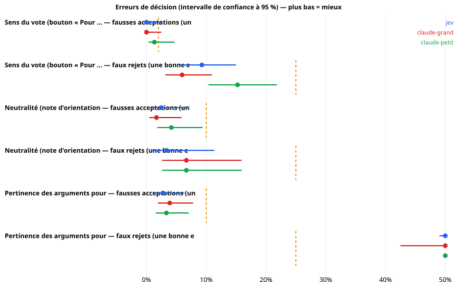

> **⚠️ DONNÉES SIMULÉES.** Ce rapport a été produit contre un serveur factice (un « Jev imaginaire ») pour tester la chaîne de mesure et montrer la forme du rapport. Aucun chiffre ci-dessous ne dit quoi que ce soit de Jev.

# Jev sur les usages réels du pipeline hémicycle

*Généré par `python -m jev_lab report`, uniquement depuis le journal brut des appels. Seuils de lecture fixés avant les mesures : voir `PROTOCOL.md`.*

## 0. Statut du run

| | |
|---|---|
| Début | 2026-10-13T15:16:19Z |
| Suite | standard |
| Commit | 0565b12 |
| Modèle Jev demandé | typesafe/jev-1.13 |
| Plafond de budget ($) | 50.0 |
| Version de Jev effectivement servie | typesafe/jev-1.13-SIMULE |
| Références (Claude via OpenRouter, même contrat que le secours de production) | `anthropic/claude-haiku-5`, `anthropic/claude-opus-5` |
| Seuils de production évalués | catégorie ≥ 0.5 ; sens P ≥ 0.85 ; pour/contre P ≥ 0.8, fond ≥ 0.6, équilibre [0.5, 1.5] ; neutralité : rejet si note > 2 |
| Jeu d'essai | Catégorie d'une fiche : 34 ; Sens du vote (bouton « Pour … ») : 302 ; Neutralité (note d'orientation) : 240 ; Pertinence des arguments pour / contre : 240 |
| Appels enregistrés | 4012 (après déduplication des reprises) |
| Dépense rapportée | 5.4595 $  (claude-grand: 5.2929 $, claude-petit: 0.1323 $, jev: 0.0343 $) |

## 1. Jev peut-il tenir ces rôles dans le pipeline ?

Chaque scénario est un appel réel du pipeline, avec ses questions et ses seuils. Deux erreurs comptent : la **fausse acceptation** (un défaut passe : bouton inversé publié, fiche orientée, arguments inversés) et le **faux rejet** (une bonne entrée est refusée : on perd une fiche et du temps de relecture). Une réponse inexploitable ou un appel échoué est comptée comme un **rejet**, comme le fait le pipeline (échec fermé). Limites de sûreté : voir `PROTOCOL.md` §5 (à valider avant le run).

| Scénario | Système | Fausses acceptations | limite | Faux rejets | limite |
|---|---|---|---|---|---|
| Sens du vote (bouton « Pour … ») | jev | 0.0 % [0.0 – 2.5] (0/151) → **inconclusif** | ≤ 2 % | 9.3 % [5.6 – 15.0] (14/151) → **respecté** | ≤ 25 % |
| Sens du vote (bouton « Pour … ») | claude-grand | 0.0 % [0.0 – 2.5] (0/151) → **inconclusif** | ≤ 2 % | 6.0 % [3.2 – 10.9] (9/151) → **respecté** | ≤ 25 % |
| Sens du vote (bouton « Pour … ») | claude-petit | 1.3 % [0.4 – 4.7] (2/151) → **inconclusif** | ≤ 2 % | 15.2 % [10.4 – 21.8] (23/151) → **respecté** | ≤ 25 % |
| Neutralité (note d'orientation) | jev | 2.5 % [0.9 – 7.1] (3/120) → **respecté** | ≤ 10 % | 3.3 % [0.9 – 11.4] (2/60) → **respecté** | ≤ 25 % |
| Neutralité (note d'orientation) | claude-grand | 1.7 % [0.5 – 5.9] (2/120) → **respecté** | ≤ 10 % | 6.7 % [2.6 – 15.9] (4/60) → **respecté** | ≤ 25 % |
| Neutralité (note d'orientation) | claude-petit | 4.2 % [1.8 – 9.4] (5/120) → **respecté** | ≤ 10 % | 6.7 % [2.6 – 15.9] (4/60) → **respecté** | ≤ 25 % |
| Pertinence des arguments pour / contre | jev | 2.8 % [1.2 – 6.3] (5/180) → **respecté** | ≤ 10 % | 61.7 % [49.0 – 72.9] (37/60) → **dépassé** | ≤ 25 % |
| Pertinence des arguments pour / contre | claude-grand | 3.9 % [1.9 – 7.8] (7/180) → **respecté** | ≤ 10 % | 55.0 % [42.5 – 66.9] (33/60) → **dépassé** | ≤ 25 % |
| Pertinence des arguments pour / contre | claude-petit | 3.3 % [1.5 – 7.1] (6/180) → **respecté** | ≤ 10 % | 75.0 % [62.8 – 84.2] (45/60) → **dépassé** | ≤ 25 % |

**Catégorie** (Jev) : exactitude 94.1 % [80.9 – 98.4] (32/34), top-3 94.1 % [80.9 – 98.4] (32/34) ; précision des catégories acceptées au seuil 0.5 : 94.1 % [80.9 – 98.4] (32/34) (objectifs : exactitude ≥ 80 %, précision des acceptées ≥ 90 %).

**Lecture.** « Respecté » = la borne haute de l'intervalle est sous la limite ; « dépassé » = la borne basse est au-dessus ; « inconclusif » = l'échantillon ne permet pas de trancher (avec 60 fiches, même zéro erreur observée laisse une borne haute d'environ 6 %). Les intervalles sont le résultat, pas la moyenne.

### Jev contre chaque référence, sur les mêmes entrées

Erreur de Jev moins erreur de la référence (négatif = Jev se trompe moins). « Au moins aussi sûr » = borne haute de l'écart sous +3 points.

| Scénario | Référence | Erreur | n | Jev | Réf. | Écart [IC 95 %] | p (Holm) | Lecture |
|---|---|---|---|---|---|---|---|---|
| Sens du vote (bouton « Pour … ») | claude-grand | fausse acceptation | 151 | 0.0 % | 0.0 % | 0.0 % [-2.5 % ; 2.5 %] | 1.000 | équivalent (à ± 3 points) |
| Sens du vote (bouton « Pour … ») | claude-grand | faux rejet | 151 | 9.3 % | 6.0 % | 3.3 % [0.2 % ; 7.2 %] | 0.188 | plus de faux rejets |
| Sens du vote (bouton « Pour … ») | claude-petit | fausse acceptation | 151 | 0.0 % | 1.3 % | -1.3 % [-4.7 % ; 1.3 %] | 1.000 | pas pire que +3 points |
| Sens du vote (bouton « Pour … ») | claude-petit | faux rejet | 151 | 9.3 % | 15.2 % | -6.0 % [-10.5 % ; -2.2 %] | 0.016 | moins de faux rejets |
| Neutralité (note d'orientation) | claude-grand | fausse acceptation | 120 | 2.5 % | 1.7 % | 0.8 % [-3.7 % ; 5.6 %] | 1.000 | inconclusif |
| Neutralité (note d'orientation) | claude-grand | faux rejet | 60 | 3.3 % | 6.7 % | -3.3 % [-13.0 % ; 5.8 %] | 1.000 | inconclusif |
| Neutralité (note d'orientation) | claude-petit | fausse acceptation | 120 | 2.5 % | 4.2 % | -1.7 % [-7.2 % ; 3.6 %] | 1.000 | inconclusif |
| Neutralité (note d'orientation) | claude-petit | faux rejet | 60 | 3.3 % | 6.7 % | -3.3 % [-13.0 % ; 5.8 %] | 1.000 | inconclusif |
| Pertinence des arguments pour / contre | claude-grand | fausse acceptation | 180 | 2.8 % | 3.9 % | -1.1 % [-5.4 % ; 3.0 %] | 1.000 | inconclusif |
| Pertinence des arguments pour / contre | claude-grand | faux rejet | 60 | 61.7 % | 55.0 % | 6.7 % [-6.9 % ; 19.8 %] | 1.000 | inconclusif |
| Pertinence des arguments pour / contre | claude-petit | fausse acceptation | 180 | 2.8 % | 3.3 % | -0.6 % [-4.7 % ; 3.5 %] | 1.000 | inconclusif |
| Pertinence des arguments pour / contre | claude-petit | faux rejet | 60 | 61.7 % | 75.0 % | -13.3 % [-27.6 % ; 1.7 %] | 0.535 | pas pire que +3 points |

⚠ 12 comparaisons : à 95 %, on s'attend à environ 1 écart(s) « significatif(s) » par pur hasard ; lire la colonne p (Holm).

## 2. Détail par scénario

### 2.1 Catégorie d'une fiche

*Production* : `fiche.py` → `classify.category`. Catégorie proposée par Jev (acceptée si confiance ≥ seuil, sinon la catégorie du rédacteur est conservée).  *Jeu d'essai* : les 34 fiches du MVP, catégorie choisie à la main. Avec 34 fiches, l'intervalle sur l'exactitude fait ± 14 points : pour trancher, il faut des étiquettes humaines supplémentaires (`content/gold/categories.jsonl`, voir README).

| Système | n | Réponses exploitables | Exactitude [IC 95 %] | Top-3 | Catégories acceptées | Précision des acceptées | ECE |
|---|---|---|---|---|---|---|---|
| jev | 34 | 100.0 % | 94.1 % [80.9 – 98.4] (32/34) | 94.1 % | 100.0 % | 94.1 % [80.9 – 98.4] (32/34) | 0.080 |
| claude-grand | 34 | 100.0 % | 97.1 % [85.1 – 99.5] (33/34) | 97.1 % | 100.0 % | 97.1 % [85.1 – 99.5] (33/34) | 0.022 |
| claude-petit | 34 | 100.0 % | 94.1 % [80.9 – 98.4] (32/34) | 94.1 % | 100.0 % | 94.1 % [80.9 – 98.4] (32/34) | 0.070 |

**Erreurs de Jev** (vérité → réponse, confiance) : #606 Éducation → Écologie & énergie (0.78) ; #7893 Sport → Écologie & énergie (0.80)

### 2.2 Sens du vote (bouton « Pour … »)

*Production* : `fiche.py` → `classify.direction`. Le bouton « Pour … » correspond-il au sens réel du vote ? (échec fermé).  *Jeu d'essai* : chaque vote est présenté deux fois, avec le bouton exact (doit être accepté) et le bouton inversé (doit être rejeté) ; fiches réelles + titres officiels supplémentaires dont le sens est certain (ensemble, suppression, amendement). La vérité vient des règles de titre : elle est fiable pour ces cas *faciles* ; les titres ambigus, pour lesquels Jev serait le plus utile, ne sont **pas** couverts (pas de vérité terrain sans étiquettes humaines).

| Système | Bon bouton accepté | **Bouton inversé accepté** | Sens du vote lu correctement | AUC (P correspond) | Réponses exploitables |
|---|---|---|---|---|---|
| jev | 90.7 % [85.0 – 94.4] (137/151) | 0.0 % [0.0 – 2.5] (0/151) | 94.7 % [89.9 – 97.3] (143/151) | 0.967 | 100.0 % |
| claude-grand | 94.0 % [89.1 – 96.8] (142/151) | 0.0 % [0.0 – 2.5] (0/151) | 96.7 % [92.5 – 98.6] (146/151) | 0.969 | 100.0 % |
| claude-petit | 84.8 % [78.2 – 89.6] (128/151) | 1.3 % [0.4 – 4.7] (2/151) | 91.4 % [85.8 – 94.9] (138/151) | 0.941 | 100.0 % |

**Par type de vote** (Jev)

| Type | Faux rejets | Fausses acceptations |
|---|---|---|
| fiche | 8.2 % [3.6 – 17.8] (5/61) | 0.0 % [0.0 – 5.9] (0/61) |
| titre_amendement | 10.0 % [3.5 – 25.6] (3/30) | 0.0 % [0.0 – 11.4] (0/30) |
| titre_suppression | 13.3 % [5.3 – 29.7] (4/30) | 0.0 % [0.0 – 11.4] (0/30) |
| titre_ensemble | 6.7 % [1.8 – 21.3] (2/30) | 0.0 % [0.0 – 11.4] (0/30) |

### 2.3 Neutralité (note d'orientation)

*Production* : `neutrality.judge` → `classify.orientation`. Note d'orientation 0–5 ; la fiche est rejetée si la note dépasse NEUTRALITY_MAX (NEUTRALITY_MAX = 2).  *Jeu d'essai* : les fiches actuelles (supposées neutres) et leurs réécritures par un modèle de langage, orientées POUR, orientées CONTRE ou au cadrage léger (`gen-variants`, à relire). **Limite** : les fiches d'origine ne sont pas prouvées neutres (le juge a déjà signalé un léger biais sur quelques-unes) et les réécritures ne sont pas validées une à une.

| Système | Note moyenne par groupe | Fiches d'origine rejetées (faux rejets) | Orientées fortes acceptées (fausses acceptations) | Cadrage léger rejeté | AUC fort vs origine |
|---|---|---|---|---|---|
| jev | orig: 0.64, pour: 3.65, contre: 3.68, subtil: 1.67 | 3.3 % [0.9 – 11.4] (2/60) | 2.5 % [0.9 – 7.1] (3/120) | 31.7 % [21.3 – 44.2] (19/60) | 0.997 |
| claude-grand | orig: 0.85, pour: 3.79, contre: 4.00, subtil: 1.93 | 6.7 % [2.6 – 15.9] (4/60) | 1.7 % [0.5 – 5.9] (2/120) | 41.7 % [30.1 – 54.3] (25/60) | 0.995 |
| claude-petit | orig: 0.82, pour: 4.00, contre: 3.94, subtil: 2.11 | 6.7 % [2.6 – 15.9] (4/60) | 4.2 % [1.8 – 9.4] (5/120) | 56.7 % [44.1 – 68.4] (34/60) | 0.990 |

### 2.4 Pertinence des arguments pour / contre

*Production* : `fiche.py` → `classify.pro_con`. Les arguments pour / contre sont-ils pertinents, sur le fond et de poids comparable ?.  *Jeu d'essai* : chaque fiche telle quelle (doit passer) et trois défauts fabriqués : arguments permutés, « contre » tronqué à 6 mots, « contre » emprunté à une autre mesure (tous doivent être rejetés).

| Système | Fiches d'origine rejetées (faux rejets) | arguments pour/contre permutés acceptés | « contre » tronqué (6 mots) acceptés | « contre » d'une autre mesure acceptés | Tous défauts acceptés | AUC |
|---|---|---|---|---|---|---|
| jev | 61.7 % [49.0 – 72.9] (37/60) | 0.0 % [0.0 – 6.0] (0/60) | 5.0 % [1.7 – 13.7] (3/60) | 3.3 % [0.9 – 11.4] (2/60) | 2.8 % [1.2 – 6.3] (5/180) | 0.817 |
| claude-grand | 55.0 % [42.5 – 66.9] (33/60) | 0.0 % [0.0 – 6.0] (0/60) | 6.7 % [2.6 – 15.9] (4/60) | 5.0 % [1.7 – 13.7] (3/60) | 3.9 % [1.9 – 7.8] (7/180) | 0.812 |
| claude-petit | 75.0 % [62.8 – 84.2] (45/60) | 0.0 % [0.0 – 6.0] (0/60) | 10.0 % [4.7 – 20.1] (6/60) | 0.0 % [0.0 – 6.0] (0/60) | 3.3 % [1.5 – 7.1] (6/180) | 0.804 |

### 2.5 Pourquoi Jev refuse de bonnes entrées

Une règle de production qui combine plusieurs conditions **cumule** leurs erreurs : une fiche est refusée si *une seule* condition échoue. Les causes ci-dessous peuvent se recouvrir (une fiche peut échouer à plusieurs conditions). À lire avant de toucher à un seuil : c'est la condition qui refuse le plus qu'il faut regarder.

| Scénario (Jev) | Bonnes entrées | Rejetées | Cause |
|---|---|---|---|
| Sens du vote (bouton « Pour … ») | 151 | 14 | réponse inexploitable ou appel échoué : **0** |
| Sens du vote (bouton « Pour … ») | 151 | 14 | P(correspond) < 0.85 : **7** |
| Sens du vote (bouton « Pour … ») | 151 | 14 | sens lu autrement que prévu : **8** |
| Neutralité (note d'orientation) | 60 | 2 | réponse inexploitable ou appel échoué : **0** |
| Neutralité (note d'orientation) | 60 | 2 | note > 2 : **2** |
| Pertinence des arguments pour / contre | 60 | 37 | réponse inexploitable ou appel échoué : **0** |
| Pertinence des arguments pour / contre | 60 | 37 | pro_ok ou con_ok < 0.8 : **4** |
| Pertinence des arguments pour / contre | 60 | 37 | argument pas « de fond » (< 0.6) : **20** |
| Pertinence des arguments pour / contre | 60 | 37 | équilibre hors de (0.5, 1.5) : **23** |

## 3. Les seuils actuels sont-ils bien placés ?

Pour Jev : ce que fait le seuil de production aujourd'hui, et le seuil que suggère l'étude (choisi sur une moitié des cas, évalué sur l'autre : jamais optimisé sur ce qui le mesure).

| Décision | Seuil actuel | Fausses acceptations (ce critère seul) | Faux rejets (ce critère seul) | Seuil suggéré (validation croisée) | à ce seuil : détection / fausse alerte |
|---|---|---|---|---|---|
| Neutralité (note d'orientation) | note > 2 (c'est toute la règle) | 2.5 % | 3.3 % | rejeter si ≥ 1.85 | 97.5 % / 6.7 % |
| Sens du vote (bouton « Pour … ») | P(correspond) ≥ 0.85 — ce critère seul (la règle complète exige aussi le bon sens) | 3.3 % | 4.6 % | rejeter si ≤ 0.09 | 96.0 % / 4.6 % |
| Pertinence des arguments pour / contre | min(pro_ok, con_ok) ≥ 0.8 — ce critère seul (la règle complète en cumule 3 autres) | 32.2 % | 6.7 % | rejeter si ≤ 0.81 | 67.8 % / 8.3 % |

*Détection* = part des défauts rejetés ; *fausse alerte* = part des bonnes entrées rejetées. Un seuil plus sévère réduit les fausses acceptations au prix de faux rejets : c'est un choix de production, pas seulement de mesure.

## 4. Temps et coût

Appels en **série**, connexion persistante, systèmes entrelacés, échauffement exclu ; durée mesurée côté client (tentative réussie). Intervalles : bootstrap **par fiche**.

| Scénario (appel de production) | jev p50 / p95 | claude-grand p50 / p95 | claude-petit p50 / p95 |
|---|---|---|---|
| Catégorie d'une fiche | 0.056 / 0.067 s | 0.175 / 0.298 s | 0.105 / 0.140 s |
| Sens du vote (bouton « Pour … ») | 0.056 / 0.071 s | 0.202 / 0.303 s | 0.095 / 0.166 s |
| Neutralité (note d'orientation) | 0.056 / 0.066 s | 0.203 / 0.311 s | 0.110 / 0.163 s |
| Pertinence des arguments pour / contre | 0.056 / 0.062 s | 0.228 / 0.393 s | 0.096 / 0.132 s |

| Système | n | p50 | p90 | p95 | p99 | IC p50 | IC p95 |
|---|---|---|---|---|---|---|---|
| jev | 120 | 0.056 s | 0.064 s | 0.068 s | 0.076 s | [0.056 ; 0.056] | [0.064 ; 0.074] |
| claude-grand | 120 | 0.206 s | 0.312 s | 0.355 s | 0.408 s | [0.188 ; 0.220] | [0.310 ; 0.404] |
| claude-petit | 120 | 0.104 s | 0.143 s | 0.152 s | 0.181 s | [0.096 ; 0.108] | [0.143 ; 0.168] |

**Une fiche = 4 appels** (catégorie, sens, neutralité, pour/contre). Durée médiane si les appels sont enchaînés : jev 0.22 s, claude-grand 0.81 s, claude-petit 0.41 s. Un lot nocturne de 50 fiches enchaînées : jev 0.2 min, claude-grand 0.7 min, claude-petit 0.3 min. *(Le pipeline lance-t-il ses appels en série ? À adapter.)*

**Débit et limites de cadence (Jev, appel pour/contre à 5 questions)**

| Concurrence | Appels | Durée | Débit | Réponses 429 | Échecs |
|---|---|---|---|---|---|
| 1 | 16 | 0.9 s | 17.9 /s | 0 | 0 |
| 2 | 16 | 0.4 s | 39.1 /s | 0 | 0 |
| 4 | 32 | 0.4 s | 71.3 /s | 0 | 0 |
| 8 | 64 | 0.4 s | 143.5 /s | 0 | 0 |

**Réessais et erreurs (tous appels)**

| Système | Appels | Réessayés | 429 | 5xx | Réseau | Échecs définitifs |
|---|---|---|---|---|---|---|
| jev | 936 | 0 | 0 | 0 | 0 | 0 |
| claude-grand | 936 | 0 | 0 | 0 | 0 | 0 |
| claude-petit | 936 | 0 | 0 | 0 | 0 | 0 |

### Coût

| Scénario | jev / appel | claude-grand / appel | claude-petit / appel |
|---|---|---|---|
| Catégorie d'une fiche | 0.000026 $ | 0.005584 $ | 0.000140 $ |
| Sens du vote (bouton « Pour … ») | 0.000010 $ | 0.003975 $ | 0.000099 $ |
| Neutralité (note d'orientation) | 0.000030 $ | 0.005891 $ | 0.000147 $ |
| Pertinence des arguments pour / contre | 0.000016 $ | 0.004688 $ | 0.000117 $ |
| **Une fiche (4 appels)** | **0.000082 $** | **0.0201 $** | **0.000503 $** |
| **1 000 fiches** | **0.0823 $** | **20.1374 $** | **0.5034 $** |

Tarif : coût facturé ÷ (tokens d'entrée × 0.042 $/M) = **1.000** sur 1848 appels Jev (5ᵉ–95ᵉ percentile 1.000 – 1.000) → conforme. Corrélation tokens de sortie / coût unitaire (≈ 0 si la sortie est gratuite) : –.

## 5. Stabilité et robustesse

**Même fiche, même appel, 5 fois.** Ce qui compte pour une porte automatique : la **décision** change-t-elle d'un passage à l'autre ? (Une fiche proche d'un seuil peut basculer.)

| Scénario | Fiches | Répétitions | Décision change | Réponse strictement identique | Écart moyen / max de la grandeur de décision |
|---|---|---|---|---|---|
| Catégorie d'une fiche | 20 | 5.0 | 0.0 % [0.0 – 16.1] (0/20) | 0.0 % | 0.073 / 0.125 |
| Sens du vote (bouton « Pour … ») | 20 | 5.0 | 0.0 % [0.0 – 16.1] (0/20) | 10.0 % | 0.028 / 0.071 |
| Neutralité (note d'orientation) | 20 | 5.0 | 0.0 % [0.0 – 16.1] (0/20) | 100.0 % | 0.000 / 0.000 |
| Pertinence des arguments pour / contre | 20 | 5.0 | 0.0 % [0.0 – 16.1] (0/20) | 0.0 % | 0.056 / 0.106 |

Global : 0.0 % [0.0 – 4.6] (0/80) (limite du protocole : 2 %).

**Catégorie : sensibilité à la rédaction de la consigne** (mêmes 34 fiches)

| Système | Variante | n | Exactitude de base | Avec la variante | Chute [IC 95 %] | Catégorie différente |
|---|---|---|---|---|---|---|
| jev | sans descriptions des catégories | 34 | 94.1 % | 94.1 % | 0.0 % [-9.0 % ; 9.0 %] | 0.0 % |
| jev | ordre des options permuté (1) | 34 | 94.1 % | 94.1 % | 0.0 % [-9.0 % ; 9.0 %] | 0.0 % |
| jev | ordre des options permuté (2) | 34 | 94.1 % | 94.1 % | 0.0 % [-9.0 % ; 9.0 %] | 0.0 % |
| claude-grand | sans descriptions des catégories | 34 | 97.1 % | 97.1 % | 0.0 % [-9.6 % ; 9.6 %] | 0.0 % |
| claude-grand | ordre des options permuté (1) | 34 | 97.1 % | 97.1 % | 0.0 % [-9.6 % ; 9.6 %] | 0.0 % |
| claude-grand | ordre des options permuté (2) | 34 | 97.1 % | 97.1 % | 0.0 % [-9.6 % ; 9.6 %] | 0.0 % |
| claude-petit | sans descriptions des catégories | 34 | 94.1 % | 94.1 % | 0.0 % [-9.0 % ; 9.0 %] | 0.0 % |
| claude-petit | ordre des options permuté (1) | 34 | 94.1 % | 94.1 % | 0.0 % [-9.0 % ; 9.0 %] | 0.0 % |
| claude-petit | ordre des options permuté (2) | 34 | 94.1 % | 94.1 % | 0.0 % [-9.0 % ; 9.0 %] | 0.0 % |

**Questions posées seules ou ensemble** (le pipeline les envoie toutes dans un appel ; les poser seules change-t-il la réponse ?)

| Scénario | Questions | Fiches | Décision différente | Écart moyen / max | Coût (ensemble → séparées) | Durée (ensemble → séparées) |
|---|---|---|---|---|---|---|
| Neutralité (note d'orientation) | 3 | 30 | 0.0 % [0.0 – 11.4] (0/30) | 0.000 / 0.000 | 0.000030 $ → 0.000064 $ | 0.057 → 0.170 s |
| Pertinence des arguments pour / contre | 5 | 30 | 0.0 % [0.0 – 11.4] (0/30) | 0.027 / 0.122 | 0.000017 $ → 0.000045 $ | 0.059 → 0.278 s |

## 6. Les fausses acceptations de Jev (ce qui passerait en production)

**Neutralité (note d'orientation)**

| Cas | Groupe | Grandeur de décision | Entrée (début) |
|---|---|---|---|
| neu-7987-pour | réécrite orientée POUR | 1.52 | title: Présomption d'usage légitime de l'arme pour policiers et gendarmes / label: la présomption de légitime défense / hook: [EN FAVEUR] Dans la rue : ce qu’un policier ou un gendarme a le droit de faire avec son arme. / sum: [EN |
| neu-5106-pour | réécrite orientée POUR | 1.58 | title: Les Frères musulmans et la liste européenne des organisations terroristes / label: la demande d'inscription des Frères musulmans sur la liste européenne des organisations terroristes / hook: [EN FAVEUR] Ce texte ne change a |
| neu-4963-pour | réécrite orientée POUR | 1.85 | title: Cadre légal spécial pour les Jeux olympiques d'hiver de 2030 / label: la loi sur les JO 2030 / hook: [EN FAVEUR] Si tu vis ou skies dans les Alpes : les JO d’hiver 2030 et leurs règles spéciales. / sum: [EN FAVEUR] Projet d |

**Pertinence des arguments pour / contre**

| Cas | Groupe | Grandeur de décision | Entrée (début) |
|---|---|---|---|
| pc-3182-contre_tronque | « contre » tronqué (6 mots) | 0.99 | mesure: le report des élections en Nouvelle-Calédonie / arguments_des_partisans: Les partisans estiment que des élections avant le 30 novembre 2025 ne pourraient pas se tenir dans de bonnes conditions : campagne de 40 jou / argume |
| pc-1624-contre_d_une_autre_mesure | « contre » d'une autre mesure | 0.96 | mesure: le renforcement de la responsabilité des mineurs délinquants et de leurs parents / arguments_des_partisans: Les partisans estiment que le cadre familial joue un rôle déterminant et que certains parents laissent la situatio |
| pc-7397-contre_tronque | « contre » tronqué (6 mots) | 0.95 | mesure: la hausse des bourses étudiantes / arguments_des_partisans: Le système actuel ne remplit plus son rôle de démocratisation de l'enseignement supérieur, et les mesures sont simples à appliquer. / arguments_des_opposants: Le  |
| pc-988-contre_tronque | « contre » tronqué (6 mots) | 0.90 | mesure: plus de soutien à l’Ukraine / arguments_des_partisans: Les partisans mettent en avant la sécurité de l'Europe et le droit international. / arguments_des_opposants: Les opposants ou abstentionnistes craignent une. |
| pc-7893-contre_d_une_autre_mesure | « contre » d'une autre mesure | 0.84 | mesure: la réforme du sport professionnel / arguments_des_partisans: Un encadrement plus strict des clubs, des agents et des rémunérations, avec un contrôle financier renforcé. / arguments_des_opposants: Les critiques redoutent un |

## 7. Limites de cette étude

- Le jeu d'essai vient du dépôt : 74 fiches dont 34 du MVP. C'est petit : lire les intervalles ; « inconclusif » ne veut pas dire « mauvais ».
- Seuls les cas *faciles* du sens du vote ont une vérité terrain automatique ; les titres ambigus (là où Jev serait le plus utile) demandent des étiquettes humaines.
- Les fiches d'origine ne sont pas prouvées neutres, et les variantes orientées sont écrites par un modèle de langage et non validées une à une.
- `sources_sufficient` (pré-contrôle du lot) n'est pas couvert : il faudrait des extraits de sources étiquetés.
- Les références (Claude) répondent au même contrat typé par une consigne JSON, sans exemples, température 0 : c'est le secours de production, pas le meilleur de ce qu'elles savent faire.
- La latence dépend du réseau, de l'heure et de la charge d'OpenRouter ; des appels identiques répétés peuvent être mis en cache côté fournisseur.
- Le modèle servi est un millésime : une conclusion ne vaut que pour lui. Refaire l'étude à chaque nouvelle version avant de changer un seuil.
