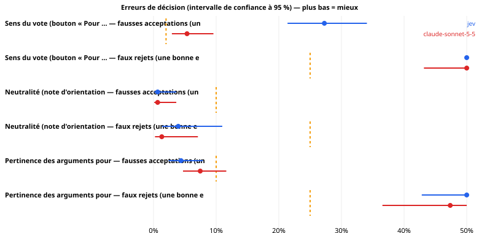
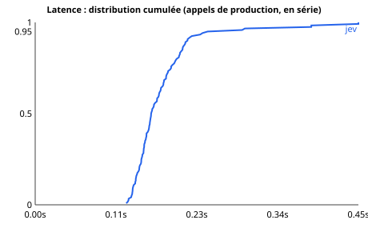

# Jev sur les usages réels du pipeline hémicycle

*Généré par `python -m jev_lab report`, uniquement depuis le journal brut des appels. Seuils de lecture fixés avant les mesures : voir `PROTOCOL.md`.*

## 0. Statut du run

| | |
|---|---|
| Début | 2026-10-14T00:20:36Z |
| Suite | standard |
| Commit | 68d70e7 |
| Modèle Jev demandé | typesafe/jev-1.13 |
| Plafond de budget ($) | 6.0 |
| Version de Jev effectivement servie | typesafe/jev-1.13-20260917 |
| Références (Claude via `claude -p`, abonnement ; même contrat que le secours de production) | `claude-sonnet-5-5` |
| Seuils de production évalués | catégorie ≥ 0.5 ; sens P ≥ 0.85 ; pour/contre P ≥ 0.8, fond ≥ 0.6, équilibre [0.5, 1.5] ; neutralité : rejet si note > 2 |
| Jeu d'essai | Catégorie d'une fiche : 34 ; Sens du vote (bouton « Pour … ») : 382 ; Neutralité (note d'orientation) : 304 ; Pertinence des arguments pour / contre : 304 |
| Sessions (reprises) | 2 — la réconciliation des crédits n'est alors plus interprétable |
| Appels enregistrés | 3442 (après déduplication des reprises) |
| Dépense rapportée | 0.0709 $  (claude-sonnet-5-5: 0.000000 $, jev: 0.0709 $) |

## 1. Jev peut-il tenir ces rôles dans le pipeline ?

Chaque scénario est un appel réel du pipeline, avec ses questions et ses seuils. Deux erreurs comptent : la **fausse acceptation** (un défaut passe : bouton inversé publié, fiche orientée, arguments inversés) et le **faux rejet** (une bonne entrée est refusée : on perd une fiche et du temps de relecture). Une réponse inexploitable ou un appel échoué est comptée comme un **rejet**, comme le fait le pipeline (échec fermé). Limites de sûreté : voir `PROTOCOL.md` §5 (à valider avant le run).

| Scénario | Système | Fausses acceptations | limite | Faux rejets | limite |
|---|---|---|---|---|---|
| Sens du vote (bouton « Pour … ») | jev | 27.3 % [21.4 – 34.1] (51/187) → **dépassé** | ≤ 2 % | 74.3 % [67.6 – 80.1] (139/187) → **dépassé** | ≤ 25 % |
| Sens du vote (bouton « Pour … ») | claude-sonnet-5-5 | 5.3 % [2.9 – 9.6] (10/187) → **dépassé** | ≤ 2 % | 50.3 % [43.2 – 57.4] (94/187) → **dépassé** | ≤ 25 % |
| Neutralité (note d'orientation) | jev | 0.7 % [0.1 – 3.6] (1/152) → **respecté** | ≤ 10 % | 3.9 % [1.4 – 11.0] (3/76) → **respecté** | ≤ 25 % |
| Neutralité (note d'orientation) | claude-sonnet-5-5 | 0.7 % [0.1 – 3.6] (1/152) → **respecté** | ≤ 10 % | 1.3 % [0.2 – 7.1] (1/76) → **respecté** | ≤ 25 % |
| Pertinence des arguments pour / contre | jev | 4.4 % [2.4 – 7.9] (10/228) → **respecté** | ≤ 10 % | 53.9 % [42.8 – 64.7] (41/76) → **dépassé** | ≤ 25 % |
| Pertinence des arguments pour / contre | claude-sonnet-5-5 | 7.5 % [4.7 – 11.6] (17/228) → **inconclusif** | ≤ 10 % | 47.4 % [36.5 – 58.4] (36/76) → **dépassé** | ≤ 25 % |

**Catégorie** (Jev) : exactitude 91.2 % [77.0 – 97.0] (31/34), top-3 97.1 % [85.1 – 99.5] (33/34) ; précision des catégories acceptées au seuil 0.5 : 91.2 % [77.0 – 97.0] (31/34) (objectifs : exactitude ≥ 80 %, précision des acceptées ≥ 90 %).

**Lecture.** « Respecté » = la borne haute de l'intervalle est sous la limite ; « dépassé » = la borne basse est au-dessus ; « inconclusif » = l'échantillon ne permet pas de trancher (avec 60 fiches, même zéro erreur observée laisse une borne haute d'environ 6 %). Les intervalles sont le résultat, pas la moyenne.

### Jev contre chaque référence, sur les mêmes entrées

Erreur de Jev moins erreur de la référence (négatif = Jev se trompe moins). « Au moins aussi sûr » = borne haute de l'écart sous +3 points.

| Scénario | Référence | Erreur | n | Jev | Réf. | Écart [IC 95 %] | p (Holm) | Lecture |
|---|---|---|---|---|---|---|---|---|
| Sens du vote (bouton « Pour … ») | claude-sonnet-5-5 | fausse acceptation | 183 | 26.2 % | 5.5 % | 20.8 % [15.1 % ; 27.0 %] | 0.000 | plus risqué |
| Sens du vote (bouton « Pour … ») | claude-sonnet-5-5 | faux rejet | 183 | 74.3 % | 49.7 % | 24.6 % [16.5 % ; 32.1 %] | 0.000 | plus de faux rejets |
| Neutralité (note d'orientation) | claude-sonnet-5-5 | fausse acceptation | 152 | 0.7 % | 0.7 % | 0.0 % [-3.0 % ; 3.0 %] | 1.000 | inconclusif |
| Neutralité (note d'orientation) | claude-sonnet-5-5 | faux rejet | 76 | 3.9 % | 1.3 % | 2.6 % [-3.7 % ; 9.8 %] | 1.000 | inconclusif |
| Pertinence des arguments pour / contre | claude-sonnet-5-5 | fausse acceptation | 228 | 4.4 % | 7.5 % | -3.1 % [-7.2 % ; 0.8 %] | 0.334 | pas pire que +3 points |
| Pertinence des arguments pour / contre | claude-sonnet-5-5 | faux rejet | 76 | 53.9 % | 47.4 % | 6.6 % [-8.0 % ; 20.8 %] | 0.487 | inconclusif |

⚠ 6 comparaisons : à 95 %, on s'attend à environ 0 écart(s) « significatif(s) » par pur hasard ; lire la colonne p (Holm).

## 2. Détail par scénario

### 2.1 Catégorie d'une fiche

*Production* : `fiche.py` → `classify.category`. Catégorie proposée par Jev (acceptée si confiance ≥ seuil, sinon la catégorie du rédacteur est conservée).  *Jeu d'essai* : les 34 fiches du MVP, catégorie choisie à la main. Avec 34 fiches, l'intervalle sur l'exactitude fait ± 14 points : pour trancher, il faut des étiquettes humaines supplémentaires (`content/gold/categories.jsonl`, voir README).

| Système | n | Réponses exploitables | Exactitude [IC 95 %] | Top-3 | Catégories acceptées | Précision des acceptées | ECE |
|---|---|---|---|---|---|---|---|
| jev | 34 | 100.0 % | 91.2 % [77.0 – 97.0] (31/34) | 97.1 % | 100.0 % | 91.2 % [77.0 – 97.0] (31/34) | 0.079 |
| claude-sonnet-5-5 | 34 | 100.0 % | 91.2 % [77.0 – 97.0] (31/34) | 100.0 % | 100.0 % | 91.2 % [77.0 – 97.0] (31/34) | – |

**Erreurs de Jev** (vérité → réponse, confiance) : #1202 Droits & société → Justice & sécurité (0.57) ; #4723 Immigration → Famille & social (0.93) ; #5412 Droits & société → Culture & médias (1.00)

### 2.2 Sens du vote (bouton « Pour … »)

*Production* : `fiche.py` → `classify.direction`. Le bouton « Pour … » correspond-il au sens réel du vote ? (échec fermé).  *Jeu d'essai* : chaque vote est présenté deux fois, avec le bouton exact (doit être accepté) et le bouton inversé (doit être rejeté) ; fiches réelles + titres officiels supplémentaires dont le sens est certain (ensemble, suppression, amendement). La vérité vient des règles de titre : elle est fiable pour ces cas *faciles* ; les titres ambigus, pour lesquels Jev serait le plus utile, ne sont **pas** couverts (pas de vérité terrain sans étiquettes humaines).

| Système | Bon bouton accepté | **Bouton inversé accepté** | Sens du vote lu correctement | AUC (P correspond) | Réponses exploitables |
|---|---|---|---|---|---|
| jev | 25.7 % [19.9 – 32.4] (48/187) | 27.3 % [21.4 – 34.1] (51/187) | 97.9 % [94.6 – 99.2] (183/187) | 0.611 | 100.0 % |
| claude-sonnet-5-5 | 49.7 % [42.6 – 56.8] (93/187) | 5.3 % [2.9 – 9.6] (10/187) | 61.0 % [53.8 – 67.7] (114/187) | 0.393 | 62.6 % |

**Par type de vote** (Jev)

| Type | Faux rejets | Fausses acceptations |
|---|---|---|
| titre_suppression | 0.0 % [0.0 – 11.4] (0/30) | 0.0 % [0.0 – 11.4] (0/30) |
| fiche | 82.5 % [73.7 – 88.8] (80/97) | 7.2 % [3.5 – 14.2] (7/97) |
| titre_amendement | 96.7 % [83.3 – 99.4] (29/30) | 100.0 % [88.6 – 100.0] (30/30) |
| titre_ensemble | 100.0 % [88.6 – 100.0] (30/30) | 46.7 % [30.2 – 63.9] (14/30) |

### 2.3 Neutralité (note d'orientation)

*Production* : `neutrality.judge` → `classify.orientation`. Note d'orientation 0–5 ; la fiche est rejetée si la note dépasse NEUTRALITY_MAX (NEUTRALITY_MAX = 2).  *Jeu d'essai* : les fiches actuelles (supposées neutres) et leurs réécritures par un modèle de langage, orientées POUR, orientées CONTRE ou au cadrage léger (`gen-variants`, à relire). **Limite** : les fiches d'origine ne sont pas prouvées neutres (le juge a déjà signalé un léger biais sur quelques-unes) et les réécritures ne sont pas validées une à une.

| Système | Note moyenne par groupe | Fiches d'origine rejetées (faux rejets) | Orientées fortes acceptées (fausses acceptations) | Cadrage léger rejeté | AUC fort vs origine |
|---|---|---|---|---|---|
| jev | orig: 1.07, pour: 3.67, contre: 3.94, subtil: 1.06 | 3.9 % [1.4 – 11.0] (3/76) | 0.7 % [0.1 – 3.6] (1/152) | 2.6 % [0.7 – 9.1] (2/76) | 0.999 |
| claude-sonnet-5-5 | orig: 1.35, pour: 3.77, contre: 4.02, subtil: 1.34 | 1.3 % [0.2 – 7.1] (1/76) | 0.7 % [0.1 – 3.6] (1/152) | 0.0 % [0.0 – 4.8] (0/76) | 0.956 |

### 2.4 Pertinence des arguments pour / contre

*Production* : `fiche.py` → `classify.pro_con`. Les arguments pour / contre sont-ils pertinents, sur le fond et de poids comparable ?.  *Jeu d'essai* : chaque fiche telle quelle (doit passer) et trois défauts fabriqués : arguments permutés, « contre » tronqué à 6 mots, « contre » emprunté à une autre mesure (tous doivent être rejetés).

| Système | Fiches d'origine rejetées (faux rejets) | arguments pour/contre permutés acceptés | « contre » tronqué (6 mots) acceptés | « contre » d'une autre mesure acceptés | Tous défauts acceptés | AUC |
|---|---|---|---|---|---|---|
| jev | 53.9 % [42.8 – 64.7] (41/76) | 0.0 % [0.0 – 4.8] (0/76) | 3.9 % [1.4 – 11.0] (3/76) | 9.2 % [4.5 – 17.8] (7/76) | 4.4 % [2.4 – 7.9] (10/228) | 0.903 |
| claude-sonnet-5-5 | 47.4 % [36.5 – 58.4] (36/76) | 0.0 % [0.0 – 4.8] (0/76) | 7.9 % [3.7 – 16.2] (6/76) | 14.5 % [8.3 – 24.1] (11/76) | 7.5 % [4.7 – 11.6] (17/228) | 0.346 |

### 2.5 Pourquoi Jev refuse de bonnes entrées

Une règle de production qui combine plusieurs conditions **cumule** leurs erreurs : une fiche est refusée si *une seule* condition échoue. Les causes ci-dessous peuvent se recouvrir (une fiche peut échouer à plusieurs conditions). À lire avant de toucher à un seuil : c'est la condition qui refuse le plus qu'il faut regarder.

| Scénario (Jev) | Bonnes entrées | Rejetées | Cause |
|---|---|---|---|
| Sens du vote (bouton « Pour … ») | 187 | 139 | réponse inexploitable ou appel échoué : **0** |
| Sens du vote (bouton « Pour … ») | 187 | 139 | P(correspond) < 0.85 : **137** |
| Sens du vote (bouton « Pour … ») | 187 | 139 | sens lu autrement que prévu : **4** |
| Neutralité (note d'orientation) | 76 | 3 | réponse inexploitable ou appel échoué : **0** |
| Neutralité (note d'orientation) | 76 | 3 | note > 2 : **3** |
| Pertinence des arguments pour / contre | 76 | 41 | réponse inexploitable ou appel échoué : **0** |
| Pertinence des arguments pour / contre | 76 | 41 | pro_ok ou con_ok < 0.8 : **12** |
| Pertinence des arguments pour / contre | 76 | 41 | argument pas « de fond » (< 0.6) : **33** |
| Pertinence des arguments pour / contre | 76 | 41 | équilibre hors de (0.5, 1.5) : **4** |

### 2.6 Pistes exploratoires (imaginées après avoir vu les résultats : à confirmer sur de nouvelles données)

Ces règles n'étaient pas dans le protocole. Elles montrent où le défaut se situe ; elles ne prouvent pas qu'elles fonctionneront sur d'autres fiches.

| Scénario | Système | Règle | Fausses acceptations | Faux rejets |
|---|---|---|---|---|
| Sens du vote (bouton « Pour … ») | jev | sens lu dans le titre seul (sans la question « correspond ») | 95.7 % [91.8 – 97.8] (179/187) | 2.1 % [0.8 – 5.4] (4/187) |
| Sens du vote (bouton « Pour … ») | claude-sonnet-5-5 | sens lu dans le titre seul (sans la question « correspond ») | 6.4 % [3.7 – 10.9] (12/187) | 39.0 % [32.3 – 46.2] (73/187) |
| Pertinence des arguments pour / contre | jev | sans la condition « de fond » (pro_ok, con_ok et équilibre seuls) | 7.9 % [5.1 – 12.1] (18/228) | 19.7 % [12.3 – 30.0] (15/76) |
| Pertinence des arguments pour / contre | claude-sonnet-5-5 | sans la condition « de fond » (pro_ok, con_ok et équilibre seuls) | 9.2 % [6.1 – 13.7] (21/228) | 44.7 % [34.1 – 55.9] (34/76) |

**Piste : le sens du vote lu dans le titre seul.** Dans le premier résultat, le « sens » donné par Jev suit le libellé du bouton plus que le titre (règle « sens lu » ci-dessus : il accepte presque tous les boutons inversés). On lui reposera donc la question de sens **sans** montrer les boutons, et on compare au sens annoncé.

| Cas | Fausses acceptations (bouton inversé accepté) | Faux rejets (bon bouton refusé) |
|---|---|---|
| Tous | 5.3 % [2.9 – 9.6] (10/187) | 4.3 % [2.2 – 8.2] (8/187) |
| fiche | 2.1 % [0.6 – 7.2] (2/97) | 2.1 % [0.6 – 7.2] (2/97) |
| titre_amendement | 0.0 % [0.0 – 11.4] (0/30) | 0.0 % [0.0 – 11.4] (0/30) |
| titre_ensemble | 0.0 % [0.0 – 11.4] (0/30) | 0.0 % [0.0 – 11.4] (0/30) |
| titre_suppression | 26.7 % [14.2 – 44.4] (8/30) | 20.0 % [9.5 – 37.3] (6/30) |

## 3. Les seuils actuels sont-ils bien placés ?

Pour Jev : ce que fait le seuil de production aujourd'hui, et le seuil que suggère l'étude (choisi sur une moitié des cas, évalué sur l'autre : jamais optimisé sur ce qui le mesure).

| Décision | Seuil actuel | Fausses acceptations (ce critère seul) | Faux rejets (ce critère seul) | Seuil suggéré (validation croisée) | à ce seuil : détection / fausse alerte |
|---|---|---|---|---|---|
| Neutralité (note d'orientation) | note > 2 (c'est toute la règle) | 0.7 % | 3.9 % | rejeter si ≥ 2.12 | 96.1 % / 0.0 % |
| Sens du vote (bouton « Pour … ») | P(correspond) ≥ 0.85 — ce critère seul (la règle complète exige aussi le bon sens) | 27.8 % | 73.3 % | rejeter si ≤ 0.68 | 39.6 % / 16.6 % |
| Pertinence des arguments pour / contre | min(pro_ok, con_ok) ≥ 0.8 — ce critère seul (la règle complète en cumule 3 autres) | 16.7 % | 15.8 % | rejeter si ≤ 0.76 | 76.8 % / 6.6 % |

*Détection* = part des défauts rejetés ; *fausse alerte* = part des bonnes entrées rejetées. Un seuil plus sévère réduit les fausses acceptations au prix de faux rejets : c'est un choix de production, pas seulement de mesure.

## 4. Temps et coût

Appels en **série**, connexion persistante, systèmes entrelacés, échauffement exclu ; durée mesurée côté client (tentative réussie). Intervalles : bootstrap **par fiche**.

| Scénario (appel de production) | jev p50 / p95 | claude-sonnet-5-5 p50 / p95 |
|---|---|---|
| Catégorie d'une fiche | 0.196 / 0.433 s | – |
| Sens du vote (bouton « Pour … ») | 0.163 / 0.209 s | – |
| Neutralité (note d'orientation) | 0.158 / 0.271 s | – |
| Pertinence des arguments pour / contre | 0.161 / 0.202 s | – |

| Système | n | p50 | p90 | p95 | p99 | IC p50 | IC p95 |
|---|---|---|---|---|---|---|---|
| jev | 120 | 0.163 s | 0.214 s | 0.245 s | 0.455 s | [0.159 ; 0.174] | [0.212 ; 0.389] |

**Une fiche = 4 appels** (catégorie, sens, neutralité, pour/contre). Durée médiane si les appels sont enchaînés : jev 0.68 s, claude-sonnet-5-5 0.00 s. Un lot nocturne de 50 fiches enchaînées : jev 0.6 min, claude-sonnet-5-5 0.0 min. *(Le pipeline lance-t-il ses appels en série ? À adapter.)*

**Débit et limites de cadence (Jev, appel pour/contre à 5 questions)**

| Concurrence | Appels | Durée | Débit | Réponses 429 | Échecs |
|---|---|---|---|---|---|
| 1 | 16 | 3.0 s | 5.4 /s | 0 | 0 |
| 2 | 16 | 1.4 s | 11.5 /s | 0 | 0 |
| 4 | 32 | 1.4 s | 22.7 /s | 0 | 0 |
| 8 | 64 | 1.6 s | 41.1 /s | 0 | 0 |

**Réessais et erreurs (tous appels)**

| Système | Appels | Réessayés | 429 | 5xx | Réseau | Échecs définitifs |
|---|---|---|---|---|---|---|
| jev | 1136 | 0 | 0 | 0 | 0 | 0 |
| claude-sonnet-5-5 | 1016 | 0 | 0 | 0 | 0 | 0 |

### Coût

| Scénario | jev / appel | claude-sonnet-5-5 / appel |
|---|---|---|
| Catégorie d'une fiche | 0.000043 $ | – |
| Sens du vote (bouton « Pour … ») | 0.000021 $ | – |
| Neutralité (note d'orientation) | 0.000045 $ | – |
| Pertinence des arguments pour / contre | 0.000026 $ | – |
| **Une fiche (4 appels)** | **0.000135 $** | – |
| **1 000 fiches** | **0.1351 $** | – |

Tarif : coût facturé ÷ (tokens d'entrée × 0.042 $/M) = **1.000** sur 2422 appels Jev (5ᵉ–95ᵉ percentile 1.000 – 1.000) → conforme. Corrélation tokens de sortie / coût unitaire (≈ 0 si la sortie est gratuite) : -0.07.

Réconciliation avec le compte OpenRouter : consommation facturée 0.0678 $ contre 0.0709 $ rapportée (écart -4.4 %) ⚠ run repris en plusieurs sessions : écart non interprétable.

## 5. Stabilité et robustesse

**Même fiche, même appel, 5 fois.** Ce qui compte pour une porte automatique : la **décision** change-t-elle d'un passage à l'autre ? (Une fiche proche d'un seuil peut basculer.)

| Scénario | Fiches | Répétitions | Décision change | Réponse strictement identique | Écart moyen / max de la grandeur de décision |
|---|---|---|---|---|---|
| Catégorie d'une fiche | 20 | 5.0 | 0.0 % [0.0 – 16.1] (0/20) | 85.0 % | 0.010 / 0.100 |
| Sens du vote (bouton « Pour … ») | 20 | 5.0 | 5.0 % [0.9 – 23.6] (1/20) | 5.0 % | 0.033 / 0.090 |
| Neutralité (note d'orientation) | 20 | 5.0 | 0.0 % [0.0 – 16.1] (0/20) | 0.0 % | 0.098 / 0.290 |
| Pertinence des arguments pour / contre | 20 | 5.0 | 0.0 % [0.0 – 16.1] (0/20) | 0.0 % | 0.027 / 0.060 |

Global : 1.2 % [0.2 – 6.7] (1/80) (limite du protocole : 2 %).

**Catégorie : sensibilité à la rédaction de la consigne** (mêmes 34 fiches)

| Système | Variante | n | Exactitude de base | Avec la variante | Chute [IC 95 %] | Catégorie différente |
|---|---|---|---|---|---|---|
| jev | sans descriptions des catégories | 34 | 91.2 % | 91.2 % | 0.0 % [-8.4 % ; 8.4 %] | 0.0 % |
| jev | ordre des options permuté (1) | 34 | 91.2 % | 91.2 % | 0.0 % [-8.4 % ; 8.4 %] | 0.0 % |
| jev | ordre des options permuté (2) | 34 | 91.2 % | 91.2 % | 0.0 % [-8.4 % ; 8.4 %] | 0.0 % |

**Questions posées seules ou ensemble** (le pipeline les envoie toutes dans un appel ; les poser seules change-t-il la réponse ?)

| Scénario | Questions | Fiches | Décision différente | Écart moyen / max | Coût (ensemble → séparées) | Durée (ensemble → séparées) |
|---|---|---|---|---|---|---|
| Neutralité (note d'orientation) | 3 | 30 | 0.0 % [0.0 – 11.4] (0/30) | 0.033 / 0.110 | 0.000046 $ → 0.000111 $ | 0.160 → 0.484 s |
| Pertinence des arguments pour / contre | 5 | 30 | 0.0 % [0.0 – 11.4] (0/30) | 0.014 / 0.040 | 0.000026 $ → 0.000096 $ | 0.151 → 0.822 s |

## 6. Les fausses acceptations de Jev (ce qui passerait en production)

**Sens du vote (bouton « Pour … »)**

| Cas | Groupe | Grandeur de décision | Entrée (début) |
|---|---|---|---|
| sens-3139-inverse | titre_amendement:inverse | 0.91 | titre_officiel_du_scrutin: l'amendement n° 1387 de M. Le Coq à l'article 4 (examen prioritaire) du projet de loi de finances pour 2026 (première lecture). / bouton_pour: Pour la suppression de la mesure examinée / bouton_contre: C |
| sens-1730-inverse | titre_amendement:inverse | 0.91 | titre_officiel_du_scrutin: l'amendement n° 148 de M. Hetzel à l'article 10 de la proposition de loi relative à l'accompagnement et aux soins palliatifs (première lectu / bouton_pour: Pour la suppression de la mesure examinée / bou |
| sens-4761-inverse | titre_amendement:inverse | 0.91 | titre_officiel_du_scrutin: l'amendement n° 164 de M. Coulomme à l'article premier du projet de loi relatif à l'organisation des jeux Olympiques et Paralympiques de 203 / bouton_pour: Pour la suppression de la mesure examinée / bou |
| sens-3378-inverse | titre_amendement:inverse | 0.90 | titre_officiel_du_scrutin: l'amendement n° 2745 de Mme Feld après l'article 3 du projet de loi de finances pour 2026 (première lecture). / bouton_pour: Pour la suppression de la mesure examinée / bouton_contre: Contre la suppressi |
| sens-555-inverse | fiche:inverse | 0.90 | titre_officiel_du_scrutin: l'article 16 du projet de loi d'urgence pour Mayotte (première lecture). / bouton_pour: Pour la suppression de l'augmentation de la réduction d'impôt pour les dons en faveur de Mayotte / bouton_contre: C |
| sens-1494-inverse | titre_amendement:inverse | 0.90 | titre_officiel_du_scrutin: l'amendement n° 713 de M. Croizier à l'article 4 bis (examen prioritaire) du projet de loi de simplification de la vie économique (première  / bouton_pour: Pour la suppression de la mesure examinée / bou |

**Neutralité (note d'orientation)**

| Cas | Groupe | Grandeur de décision | Entrée (début) |
|---|---|---|---|
| neu-3056-pour | réécrite orientée POUR | 1.89 | title: Simplification du droit de l'urbanisme et du logement / label: la simplification du droit de l'urbanisme et du logement / hook: Enfin des règles plus simples et plus rapides pour construire ou transformer un logement près d |

**Pertinence des arguments pour / contre**

| Cas | Groupe | Grandeur de décision | Entrée (début) |
|---|---|---|---|
| pc-4745-contre_d_une_autre_mesure | « contre » d'une autre mesure | 0.90 | mesure: l’encadrement des loyers / arguments_des_partisans: Les partisans veulent limiter la hausse des loyers et protéger les locataires qui font valoir leurs droits. / arguments_des_opposants: Les opposants craignent une atteint |
| pc-606-contre_tronque | « contre » tronqué (6 mots) | 0.90 | mesure: le repas à 1 € pour tous / arguments_des_partisans: Les partisans mettent en avant la précarité étudiante et l'accès à un repas équilibré. / arguments_des_opposants: Les opposants jugent la mesure coûteuse. |
| pc-4745-contre_tronque | « contre » tronqué (6 mots) | 0.88 | mesure: l’encadrement des loyers / arguments_des_partisans: Les partisans veulent limiter la hausse des loyers et protéger les locataires qui font valoir leurs droits. / arguments_des_opposants: Les opposants craignent que l'encad |
| pc-8427-contre_d_une_autre_mesure | « contre » d'une autre mesure | 0.88 | mesure: la loi d'urgence pour la protection et la souveraineté agricoles / arguments_des_partisans: Les partisans estiment que le texte protège les producteurs français d'une concurrence qui ne respecte pas les mêmes normes. Ils j |
| pc-555-contre_d_une_autre_mesure | « contre » d'une autre mesure | 0.88 | mesure: l'augmentation de la réduction d'impôt pour les dons en faveur de Mayotte / arguments_des_partisans: Les partisans estiment qu'une réduction d'impôt plus forte encourage les dons pour Mayotte et envoie un signal en faveur  |
| pc-242-contre_d_une_autre_mesure | « contre » d'une autre mesure | 0.87 | mesure: l'adoption des recettes et de l'équilibre de la sécurité sociale pour 2025 / arguments_des_partisans: Les partisans estiment que le calcul sur les 25 meilleures années améliore les droits à pension des exploitants agricole |

## 7. Limites de cette étude

- Le jeu d'essai vient du dépôt : 74 fiches dont 34 du MVP. C'est petit : lire les intervalles ; « inconclusif » ne veut pas dire « mauvais ».
- Seuls les cas *faciles* du sens du vote ont une vérité terrain automatique ; les titres ambigus (là où Jev serait le plus utile) demandent des étiquettes humaines.
- Les fiches d'origine ne sont pas prouvées neutres, et les variantes orientées sont écrites par un modèle de langage et non validées une à une.
- `sources_sufficient` (pré-contrôle du lot) n'est pas couvert : il faudrait des extraits de sources étiquetés.
- Les références (Claude) répondent au même contrat typé par une consigne JSON, sans exemples, température 0 : c'est le secours de production, pas le meilleur de ce qu'elles savent faire.
- La latence dépend du réseau, de l'heure et de la charge d'OpenRouter ; des appels identiques répétés peuvent être mis en cache côté fournisseur.
- Le modèle servi est un millésime : une conclusion ne vaut que pour lui. Refaire l'étude à chaque nouvelle version avant de changer un seuil.
