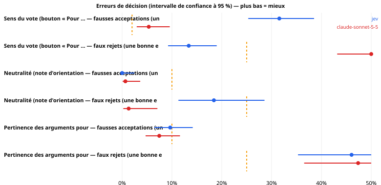
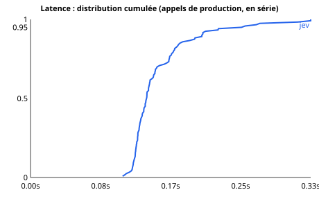

# Jev sur les usages réels du pipeline hémicycle

*Généré par `python -m jev_lab report`, uniquement depuis le journal brut des appels. Seuils de lecture fixés avant les mesures : voir `PROTOCOL.md`.*

## 0. Statut du run

| | |
|---|---|
| Début | 2026-10-14T06:35:07Z |
| Suite | standard |
| Commit | 80f418a |
| Modèle Jev demandé | openai/gpt-6-luna-decisions |
| Plafond de budget ($) | 6.0 |
| Version de Jev effectivement servie | openai/gpt-6-luna-decisions-20261006 |
| Références (Claude via OpenRouter, même contrat que le secours de production) | `claude-sonnet-5-5` |
| Seuils de production évalués | catégorie ≥ 0.5 ; sens P ≥ 0.85 ; pour/contre P ≥ 0.8, fond ≥ 0.6, équilibre [0.5, 1.5] ; neutralité : rejet si note > 2 |
| Jeu d'essai | Catégorie d'une fiche : 34 ; Sens du vote (bouton « Pour … ») : 382 ; Neutralité (note d'orientation) : 304 ; Pertinence des arguments pour / contre : 304 |
| Sessions (reprises) | 2 — la réconciliation des crédits n'est alors plus interprétable |
| Appels enregistrés | 3442 (après déduplication des reprises) |
| Dépense rapportée | 0.1484 $  (claude-sonnet-5-5: 0.000000 $, jev: 0.1484 $) |

## 1. Jev peut-il tenir ces rôles dans le pipeline ?

Chaque scénario est un appel réel du pipeline, avec ses questions et ses seuils. Deux erreurs comptent : la **fausse acceptation** (un défaut passe : bouton inversé publié, fiche orientée, arguments inversés) et le **faux rejet** (une bonne entrée est refusée : on perd une fiche et du temps de relecture). Une réponse inexploitable ou un appel échoué est comptée comme un **rejet**, comme le fait le pipeline (échec fermé). Limites de sûreté : voir `PROTOCOL.md` §5 (à valider avant le run).

| Scénario | Système | Fausses acceptations | limite | Faux rejets | limite |
|---|---|---|---|---|---|
| Sens du vote (bouton « Pour … ») | jev | 31.6 % [25.3 – 38.5] (59/187) → **dépassé** | ≤ 2 % | 13.4 % [9.2 – 19.0] (25/187) → **respecté** | ≤ 25 % |
| Sens du vote (bouton « Pour … ») | claude-sonnet-5-5 | 5.3 % [2.9 – 9.6] (10/187) → **dépassé** | ≤ 2 % | 50.3 % [43.2 – 57.4] (94/187) → **dépassé** | ≤ 25 % |
| Neutralité (note d'orientation) | jev | 0.0 % [0.0 – 2.5] (0/152) → **respecté** | ≤ 10 % | 18.4 % [11.3 – 28.6] (14/76) → **inconclusif** | ≤ 25 % |
| Neutralité (note d'orientation) | claude-sonnet-5-5 | 0.7 % [0.1 – 3.6] (1/152) → **respecté** | ≤ 10 % | 1.3 % [0.2 – 7.1] (1/76) → **respecté** | ≤ 25 % |
| Pertinence des arguments pour / contre | jev | 9.6 % [6.5 – 14.2] (22/228) → **inconclusif** | ≤ 10 % | 46.1 % [35.3 – 57.2] (35/76) → **dépassé** | ≤ 25 % |
| Pertinence des arguments pour / contre | claude-sonnet-5-5 | 7.5 % [4.7 – 11.6] (17/228) → **inconclusif** | ≤ 10 % | 47.4 % [36.5 – 58.4] (36/76) → **dépassé** | ≤ 25 % |

**Catégorie** (Jev) : exactitude 94.1 % [80.9 – 98.4] (32/34), top-3 97.1 % [85.1 – 99.5] (33/34) ; précision des catégories acceptées au seuil 0.5 : 94.1 % [80.9 – 98.4] (32/34) (objectifs : exactitude ≥ 80 %, précision des acceptées ≥ 90 %).

**Lecture.** « Respecté » = la borne haute de l'intervalle est sous la limite ; « dépassé » = la borne basse est au-dessus ; « inconclusif » = l'échantillon ne permet pas de trancher (avec 60 fiches, même zéro erreur observée laisse une borne haute d'environ 6 %). Les intervalles sont le résultat, pas la moyenne.

### Jev contre chaque référence, sur les mêmes entrées

Erreur de Jev moins erreur de la référence (négatif = Jev se trompe moins). « Au moins aussi sûr » = borne haute de l'écart sous +3 points.

| Scénario | Référence | Erreur | n | Jev | Réf. | Écart [IC 95 %] | p (Holm) | Lecture |
|---|---|---|---|---|---|---|---|---|
| Sens du vote (bouton « Pour … ») | claude-sonnet-5-5 | fausse acceptation | 183 | 30.6 % | 5.5 % | 25.1 % [19.0 % ; 31.7 %] | 0.000 | plus risqué |
| Sens du vote (bouton « Pour … ») | claude-sonnet-5-5 | faux rejet | 183 | 13.7 % | 49.7 % | -36.1 % [-43.6 % ; -27.9 %] | 0.000 | moins de faux rejets |
| Neutralité (note d'orientation) | claude-sonnet-5-5 | fausse acceptation | 152 | 0.0 % | 0.7 % | -0.7 % [-3.6 % ; 1.9 %] | 1.000 | pas pire que +3 points |
| Neutralité (note d'orientation) | claude-sonnet-5-5 | faux rejet | 76 | 18.4 % | 1.3 % | 17.1 % [7.7 % ; 27.4 %] | 0.002 | plus de faux rejets |
| Pertinence des arguments pour / contre | claude-sonnet-5-5 | fausse acceptation | 228 | 9.6 % | 7.5 % | 2.2 % [-2.2 % ; 6.7 %] | 0.849 | inconclusif |
| Pertinence des arguments pour / contre | claude-sonnet-5-5 | faux rejet | 76 | 46.1 % | 47.4 % | -1.3 % [-15.3 % ; 12.7 %] | 1.000 | inconclusif |

⚠ 6 comparaisons : à 95 %, on s'attend à environ 0 écart(s) « significatif(s) » par pur hasard ; lire la colonne p (Holm).

## 2. Détail par scénario

### 2.1 Catégorie d'une fiche

*Production* : `fiche.py` → `classify.category`. Catégorie proposée par Jev (acceptée si confiance ≥ seuil, sinon la catégorie du rédacteur est conservée).  *Jeu d'essai* : les 34 fiches du MVP, catégorie choisie à la main. Avec 34 fiches, l'intervalle sur l'exactitude fait ± 14 points : pour trancher, il faut des étiquettes humaines supplémentaires (`content/gold/categories.jsonl`, voir README).

| Système | n | Réponses exploitables | Exactitude [IC 95 %] | Top-3 | Catégories acceptées | Précision des acceptées | ECE |
|---|---|---|---|---|---|---|---|
| jev | 34 | 100.0 % | 94.1 % [80.9 – 98.4] (32/34) | 97.1 % | 100.0 % | 94.1 % [80.9 – 98.4] (32/34) | 0.067 |
| claude-sonnet-5-5 | 34 | 100.0 % | 91.2 % [77.0 – 97.0] (31/34) | 100.0 % | 100.0 % | 91.2 % [77.0 – 97.0] (31/34) | – |

**Erreurs de Jev** (vérité → réponse, confiance) : #4723 Immigration → Famille & social (0.78) ; #5412 Droits & société → Culture & médias (1.00)

### 2.2 Sens du vote (bouton « Pour … »)

*Production* : `fiche.py` → `classify.direction`. Le bouton « Pour … » correspond-il au sens réel du vote ? (échec fermé).  *Jeu d'essai* : chaque vote est présenté deux fois, avec le bouton exact (doit être accepté) et le bouton inversé (doit être rejeté) ; fiches réelles + titres officiels supplémentaires dont le sens est certain (ensemble, suppression, amendement). La vérité vient des règles de titre : elle est fiable pour ces cas *faciles* ; les titres ambigus, pour lesquels Jev serait le plus utile, ne sont **pas** couverts (pas de vérité terrain sans étiquettes humaines).

| Système | Bon bouton accepté | **Bouton inversé accepté** | Sens du vote lu correctement | AUC (P correspond) | Réponses exploitables |
|---|---|---|---|---|---|
| jev | 86.6 % [81.0 – 90.8] (162/187) | 31.6 % [25.3 – 38.5] (59/187) | 98.9 % [96.2 – 99.7] (185/187) | 0.814 | 100.0 % |
| claude-sonnet-5-5 | 49.7 % [42.6 – 56.8] (93/187) | 5.3 % [2.9 – 9.6] (10/187) | 61.0 % [53.8 – 67.7] (114/187) | 0.393 | 62.6 % |

**Par type de vote** (Jev)

| Type | Faux rejets | Fausses acceptations |
|---|---|---|
| titre_suppression | 0.0 % [0.0 – 11.4] (0/30) | 0.0 % [0.0 – 11.4] (0/30) |
| fiche | 25.8 % [18.1 – 35.3] (25/97) | 18.6 % [12.1 – 27.4] (18/97) |
| titre_amendement | 0.0 % [0.0 – 11.4] (0/30) | 96.7 % [83.3 – 99.4] (29/30) |
| titre_ensemble | 0.0 % [0.0 – 11.4] (0/30) | 40.0 % [24.6 – 57.7] (12/30) |

### 2.3 Neutralité (note d'orientation)

*Production* : `neutrality.judge` → `classify.orientation`. Note d'orientation 0–5 ; la fiche est rejetée si la note dépasse NEUTRALITY_MAX (NEUTRALITY_MAX = 2).  *Jeu d'essai* : les fiches actuelles (supposées neutres) et leurs réécritures par un modèle de langage, orientées POUR, orientées CONTRE ou au cadrage léger (`gen-variants`, à relire). **Limite** : les fiches d'origine ne sont pas prouvées neutres (le juge a déjà signalé un léger biais sur quelques-unes) et les réécritures ne sont pas validées une à une.

| Système | Note moyenne par groupe | Fiches d'origine rejetées (faux rejets) | Orientées fortes acceptées (fausses acceptations) | Cadrage léger rejeté | AUC fort vs origine |
|---|---|---|---|---|---|
| jev | orig: 1.43, pour: 4.54, contre: 4.62, subtil: 1.49 | 18.4 % [11.3 – 28.6] (14/76) | 0.0 % [0.0 – 2.5] (0/152) | 15.8 % [9.3 – 25.6] (12/76) | 1.000 |
| claude-sonnet-5-5 | orig: 1.35, pour: 3.77, contre: 4.02, subtil: 1.34 | 1.3 % [0.2 – 7.1] (1/76) | 0.7 % [0.1 – 3.6] (1/152) | 0.0 % [0.0 – 4.8] (0/76) | 0.956 |

### 2.4 Pertinence des arguments pour / contre

*Production* : `fiche.py` → `classify.pro_con`. Les arguments pour / contre sont-ils pertinents, sur le fond et de poids comparable ?.  *Jeu d'essai* : chaque fiche telle quelle (doit passer) et trois défauts fabriqués : arguments permutés, « contre » tronqué à 6 mots, « contre » emprunté à une autre mesure (tous doivent être rejetés).

| Système | Fiches d'origine rejetées (faux rejets) | arguments pour/contre permutés acceptés | « contre » tronqué (6 mots) acceptés | « contre » d'une autre mesure acceptés | Tous défauts acceptés | AUC |
|---|---|---|---|---|---|---|
| jev | 46.1 % [35.3 – 57.2] (35/76) | 0.0 % [0.0 – 4.8] (0/76) | 0.0 % [0.0 – 4.8] (0/76) | 28.9 % [20.0 – 40.0] (22/76) | 9.6 % [6.5 – 14.2] (22/228) | 0.818 |
| claude-sonnet-5-5 | 47.4 % [36.5 – 58.4] (36/76) | 0.0 % [0.0 – 4.8] (0/76) | 7.9 % [3.7 – 16.2] (6/76) | 14.5 % [8.3 – 24.1] (11/76) | 7.5 % [4.7 – 11.6] (17/228) | 0.346 |

### 2.5 Pourquoi Jev refuse de bonnes entrées

Une règle de production qui combine plusieurs conditions **cumule** leurs erreurs : une fiche est refusée si *une seule* condition échoue. Les causes ci-dessous peuvent se recouvrir (une fiche peut échouer à plusieurs conditions). À lire avant de toucher à un seuil : c'est la condition qui refuse le plus qu'il faut regarder.

| Scénario (Jev) | Bonnes entrées | Rejetées | Cause |
|---|---|---|---|
| Sens du vote (bouton « Pour … ») | 187 | 25 | réponse inexploitable ou appel échoué : **0** |
| Sens du vote (bouton « Pour … ») | 187 | 25 | P(correspond) < 0.85 : **23** |
| Sens du vote (bouton « Pour … ») | 187 | 25 | sens lu autrement que prévu : **2** |
| Neutralité (note d'orientation) | 76 | 14 | réponse inexploitable ou appel échoué : **0** |
| Neutralité (note d'orientation) | 76 | 14 | note > 2 : **14** |
| Pertinence des arguments pour / contre | 76 | 35 | réponse inexploitable ou appel échoué : **0** |
| Pertinence des arguments pour / contre | 76 | 35 | pro_ok ou con_ok < 0.8 : **2** |
| Pertinence des arguments pour / contre | 76 | 35 | argument pas « de fond » (< 0.6) : **27** |
| Pertinence des arguments pour / contre | 76 | 35 | équilibre hors de (0.5, 1.5) : **8** |

### 2.6 Pistes exploratoires (imaginées après avoir vu les résultats : à confirmer sur de nouvelles données)

Ces règles n'étaient pas dans le protocole. Elles montrent où le défaut se situe ; elles ne prouvent pas qu'elles fonctionneront sur d'autres fiches.

| Scénario | Système | Règle | Fausses acceptations | Faux rejets |
|---|---|---|---|---|
| Sens du vote (bouton « Pour … ») | jev | sens lu dans le titre seul (sans la question « correspond ») | 73.3 % [66.5 – 79.1] (137/187) | 1.1 % [0.3 – 3.8] (2/187) |
| Sens du vote (bouton « Pour … ») | claude-sonnet-5-5 | sens lu dans le titre seul (sans la question « correspond ») | 6.4 % [3.7 – 10.9] (12/187) | 39.0 % [32.3 – 46.2] (73/187) |
| Pertinence des arguments pour / contre | jev | sans la condition « de fond » (pro_ok, con_ok et équilibre seuls) | 14.9 % [10.9 – 20.1] (34/228) | 11.8 % [6.4 – 21.0] (9/76) |
| Pertinence des arguments pour / contre | claude-sonnet-5-5 | sans la condition « de fond » (pro_ok, con_ok et équilibre seuls) | 9.2 % [6.1 – 13.7] (21/228) | 44.7 % [34.1 – 55.9] (34/76) |

**Piste : le sens du vote lu dans le titre seul.** Dans le premier résultat, le « sens » donné par Jev suit le libellé du bouton plus que le titre (règle « sens lu » ci-dessus : il accepte presque tous les boutons inversés). On lui reposera donc la question de sens **sans** montrer les boutons, et on compare au sens annoncé.

| Cas | Fausses acceptations (bouton inversé accepté) | Faux rejets (bon bouton refusé) |
|---|---|---|
| Tous | 0.5 % [0.1 – 3.0] (1/187) | 2.7 % [1.1 – 6.1] (5/187) |
| fiche | 1.0 % [0.2 – 5.6] (1/97) | 2.1 % [0.6 – 7.2] (2/97) |
| titre_amendement | 0.0 % [0.0 – 11.4] (0/30) | 10.0 % [3.5 – 25.6] (3/30) |
| titre_ensemble | 0.0 % [0.0 – 11.4] (0/30) | 0.0 % [0.0 – 11.4] (0/30) |
| titre_suppression | 0.0 % [0.0 – 11.4] (0/30) | 0.0 % [0.0 – 11.4] (0/30) |

## 3. Les seuils actuels sont-ils bien placés ?

Pour Jev : ce que fait le seuil de production aujourd'hui, et le seuil que suggère l'étude (choisi sur une moitié des cas, évalué sur l'autre : jamais optimisé sur ce qui le mesure).

| Décision | Seuil actuel | Fausses acceptations (ce critère seul) | Faux rejets (ce critère seul) | Seuil suggéré (validation croisée) | à ce seuil : détection / fausse alerte |
|---|---|---|---|---|---|
| Neutralité (note d'orientation) | note > 2 (c'est toute la règle) | 0.0 % | 18.4 % | rejeter si ≥ 2.91 | 98.7 % / 0.0 % |
| Sens du vote (bouton « Pour … ») | P(correspond) ≥ 0.85 — ce critère seul (la règle complète exige aussi le bon sens) | 47.1 % | 12.3 % | rejeter si ≤ 0.94 | 74.3 % / 26.2 % |
| Pertinence des arguments pour / contre | min(pro_ok, con_ok) ≥ 0.8 — ce critère seul (la règle complète en cumule 3 autres) | 43.6 % | 2.6 % | rejeter si ≤ 0.70 | 61.0 % / 7.9 % |

*Détection* = part des défauts rejetés ; *fausse alerte* = part des bonnes entrées rejetées. Un seuil plus sévère réduit les fausses acceptations au prix de faux rejets : c'est un choix de production, pas seulement de mesure.

## 4. Temps et coût

Appels en **série**, connexion persistante, systèmes entrelacés, échauffement exclu ; durée mesurée côté client (tentative réussie). Intervalles : bootstrap **par fiche**.

| Scénario (appel de production) | jev p50 / p95 | claude-sonnet-5-5 p50 / p95 |
|---|---|---|
| Catégorie d'une fiche | 0.128 / 0.305 s | – |
| Sens du vote (bouton « Pour … ») | 0.137 / 0.200 s | – |
| Neutralité (note d'orientation) | 0.136 / 0.203 s | – |
| Pertinence des arguments pour / contre | 0.146 / 0.237 s | – |

| Système | n | p50 | p90 | p95 | p99 | IC p50 | IC p95 |
|---|---|---|---|---|---|---|---|
| jev | 120 | 0.137 s | 0.203 s | 0.250 s | 0.332 s | [0.134 ; 0.141] | [0.203 ; 0.316] |

**Une fiche = 4 appels** (catégorie, sens, neutralité, pour/contre). Durée médiane si les appels sont enchaînés : jev 0.55 s, claude-sonnet-5-5 0.00 s. Un lot nocturne de 50 fiches enchaînées : jev 0.5 min, claude-sonnet-5-5 0.0 min. *(Le pipeline lance-t-il ses appels en série ? À adapter.)*

**Débit et limites de cadence (Jev, appel pour/contre à 5 questions)**

| Concurrence | Appels | Durée | Débit | Réponses 429 | Échecs |
|---|---|---|---|---|---|
| 1 | 16 | 2.4 s | 6.6 /s | 0 | 0 |
| 2 | 16 | 1.5 s | 10.6 /s | 0 | 0 |
| 4 | 32 | 1.7 s | 19.2 /s | 0 | 0 |
| 8 | 64 | 1.6 s | 40.2 /s | 0 | 0 |

**Réessais et erreurs (tous appels)**

| Système | Appels | Réessayés | 429 | 5xx | Réseau | Échecs définitifs |
|---|---|---|---|---|---|---|
| jev | 1136 | 10 | 0 | 40 | 0 | 10 |
| claude-sonnet-5-5 | 1016 | 0 | 0 | 0 | 0 | 0 |

### Coût

| Scénario | jev / appel | claude-sonnet-5-5 / appel |
|---|---|---|
| Catégorie d'une fiche | 0.000061 $ | – |
| Sens du vote (bouton « Pour … ») | 0.000041 $ | – |
| Neutralité (note d'orientation) | 0.000093 $ | – |
| Pertinence des arguments pour / contre | 0.000094 $ | – |
| **Une fiche (4 appels)** | **0.000289 $** | – |
| **1 000 fiches** | **0.2891 $** | – |

Tarif : coût facturé ÷ (tokens d'entrée × 0.1 $/M) = **1.000** sur 2398 appels Jev (5ᵉ–95ᵉ percentile 1.000 – 1.000) → conforme. Corrélation tokens de sortie / coût unitaire (≈ 0 si la sortie est gratuite) : –.

Réconciliation avec le compte OpenRouter : consommation facturée 0.1341 $ contre 0.1484 $ rapportée (écart -9.6 %) ⚠ run repris en plusieurs sessions : écart non interprétable.

## 5. Stabilité et robustesse

**Même fiche, même appel, 5 fois.** Ce qui compte pour une porte automatique : la **décision** change-t-elle d'un passage à l'autre ? (Une fiche proche d'un seuil peut basculer.)

| Scénario | Fiches | Répétitions | Décision change | Réponse strictement identique | Écart moyen / max de la grandeur de décision |
|---|---|---|---|---|---|
| Catégorie d'une fiche | 20 | 5.0 | 0.0 % [0.0 – 16.1] (0/20) | 100.0 % | 0.000 / 0.000 |
| Sens du vote (bouton « Pour … ») | 20 | 5.0 | 0.0 % [0.0 – 16.1] (0/20) | 100.0 % | 0.000 / 0.000 |
| Neutralité (note d'orientation) | 20 | 5.0 | 0.0 % [0.0 – 16.1] (0/20) | 100.0 % | 0.000 / 0.000 |
| Pertinence des arguments pour / contre | 20 | 5.0 | 0.0 % [0.0 – 16.1] (0/20) | 100.0 % | 0.000 / 0.000 |

Global : 0.0 % [0.0 – 4.6] (0/80) (limite du protocole : 2 %).

**Catégorie : sensibilité à la rédaction de la consigne** (mêmes 34 fiches)

| Système | Variante | n | Exactitude de base | Avec la variante | Chute [IC 95 %] | Catégorie différente |
|---|---|---|---|---|---|---|
| jev | sans descriptions des catégories | 34 | 94.1 % | 94.1 % | 0.0 % [-11.8 % ; 11.8 %] | 5.9 % |
| jev | ordre des options permuté (1) | 34 | 94.1 % | 94.1 % | 0.0 % [-9.0 % ; 9.0 %] | 0.0 % |
| jev | ordre des options permuté (2) | 34 | 94.1 % | 94.1 % | 0.0 % [-9.0 % ; 9.0 %] | 0.0 % |

**Questions posées seules ou ensemble** (le pipeline les envoie toutes dans un appel ; les poser seules change-t-il la réponse ?)

| Scénario | Questions | Fiches | Décision différente | Écart moyen / max | Coût (ensemble → séparées) | Durée (ensemble → séparées) |
|---|---|---|---|---|---|---|
| Neutralité (note d'orientation) | 3 | 30 | 0.0 % [0.0 – 11.4] (0/30) | 0.000 / 0.000 | 0.000096 $ → 0.000180 $ | 0.140 → 0.430 s |
| Pertinence des arguments pour / contre | 5 | 27 | 0.0 % [0.0 – 12.5] (0/27) | 0.000 / 0.000 | 0.000094 $ → 0.000146 $ | 0.181 → 0.776 s |

## 6. Les fausses acceptations de Jev (ce qui passerait en production)

**Sens du vote (bouton « Pour … »)**

| Cas | Groupe | Grandeur de décision | Entrée (début) |
|---|---|---|---|
| sens-7003-inverse | titre_ensemble:inverse | 1.00 | titre_officiel_du_scrutin: l'article unique de la proposition de loi visant à étendre à toutes les communes la compensation financière prévue pour les communes de plus / bouton_pour: Pour la suppression de la mesure examinée / bou |
| sens-684-inverse | titre_ensemble:inverse | 1.00 | titre_officiel_du_scrutin: l'article unique de la proposition de résolution européenne relative à l'adoption et à la mise en œuvre d'exigences à l'importation pour le  / bouton_pour: Pour la suppression de la mesure examinée / bou |
| sens-2550-inverse | titre_amendement:inverse | 1.00 | titre_officiel_du_scrutin: l'amendement n° 261 rectifé de Mme Stambach-Terrenoir à l'article 5 de la proposition de loi portant programmation nationale énergie et clim / bouton_pour: Pour la suppression de la mesure examinée / bou |
| sens-2742-inverse | fiche:inverse | 1.00 | titre_officiel_du_scrutin: l'article 1er A de la proposition de loi visant à renforcer les prérogatives des officiers de l'état-civil et du ministère public pour lutte / bouton_pour: Pour la suppression de l'obligation, pour un fu |
| sens-3151-inverse | fiche:inverse | 1.00 | titre_officiel_du_scrutin: l'article 4 (examen prioritaire) du projet de loi de finances pour 2026 (première lecture). / bouton_pour: Pour la suppression de la surtaxe sur les grandes entreprises / bouton_contre: Contre la suppres |
| sens-5604-inverse | titre_amendement:inverse | 0.99 | titre_officiel_du_scrutin: l'amendement n° 280 de M. Bazin et l'amendement identique suivant à l'article 6 de la proposition de loi relative au droit à l'aide à mourir / bouton_pour: Pour la suppression de la mesure examinée / bou |

**Pertinence des arguments pour / contre**

| Cas | Groupe | Grandeur de décision | Entrée (début) |
|---|---|---|---|
| pc-4745-contre_d_une_autre_mesure | « contre » d'une autre mesure | 1.00 | mesure: l’encadrement des loyers / arguments_des_partisans: Les partisans veulent limiter la hausse des loyers et protéger les locataires qui font valoir leurs droits. / arguments_des_opposants: Les opposants craignent une atteint |
| pc-2958-contre_d_une_autre_mesure | « contre » d'une autre mesure | 1.00 | mesure: l'allongement de la rétention de certains étrangers condamnés / arguments_des_partisans: Les pays d'origine acceptent difficilement le retour de personnes condamnées pour des infractions graves, ce qui demande plus de temp |
| pc-242-contre_d_une_autre_mesure | « contre » d'une autre mesure | 1.00 | mesure: l'adoption des recettes et de l'équilibre de la sécurité sociale pour 2025 / arguments_des_partisans: Les partisans estiment que le calcul sur les 25 meilleures années améliore les droits à pension des exploitants agricole |
| pc-8427-contre_d_une_autre_mesure | « contre » d'une autre mesure | 1.00 | mesure: la loi d'urgence pour la protection et la souveraineté agricoles / arguments_des_partisans: Les partisans estiment que le texte protège les producteurs français d'une concurrence qui ne respecte pas les mêmes normes. Ils j |
| pc-8421-contre_d_une_autre_mesure | « contre » d'une autre mesure | 1.00 | mesure: la loi pour une montagne vivante et souveraine / arguments_des_partisans: Les territoires de montagne ont des contraintes propres, comme des trajets scolaires plus longs et plus risqués en hiver. Le texte adapte l' / argum |
| pc-3260-contre_d_une_autre_mesure | « contre » d'une autre mesure | 1.00 | mesure: la fin des accords avec l’Algérie / arguments_des_partisans: Les partisans jugent ce régime particulier dépassé et veulent revenir aux règles communes. / arguments_des_opposants: Les opposants craignent que l'encadrement d |

## 7. Limites de cette étude

- Le jeu d'essai vient du dépôt : 74 fiches dont 34 du MVP. C'est petit : lire les intervalles ; « inconclusif » ne veut pas dire « mauvais ».
- Seuls les cas *faciles* du sens du vote ont une vérité terrain automatique ; les titres ambigus (là où Jev serait le plus utile) demandent des étiquettes humaines.
- Les fiches d'origine ne sont pas prouvées neutres, et les variantes orientées sont écrites par un modèle de langage et non validées une à une.
- `sources_sufficient` (pré-contrôle du lot) n'est pas couvert : il faudrait des extraits de sources étiquetés.
- Les références (Claude) répondent au même contrat typé par une consigne JSON, sans exemples, température 0 : c'est le secours de production, pas le meilleur de ce qu'elles savent faire.
- La latence dépend du réseau, de l'heure et de la charge d'OpenRouter ; des appels identiques répétés peuvent être mis en cache côté fournisseur.
- Le modèle servi est un millésime : une conclusion ne vaut que pour lui. Refaire l'étude à chaque nouvelle version avant de changer un seuil.
